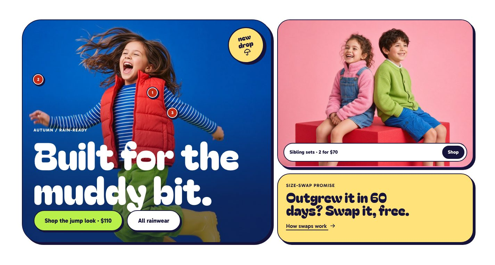

# Introduction

**Pipsy** is a premium WooCommerce theme for kids fashion stores: baby, toddler and kids clothing, gifts and matching family sets. It is built with Elementor and Kitify, and every page of the demo (home, header, footer, shop, product, Journal and help pages) can be edited visually.

<figure><figcaption>
The Pipsy home page
</figcaption></figure>

What makes Pipsy different from a general fashion theme:

* **Shopping by age and height.** Sizes carry a height range, so shoppers can find a size from a child's height with the [Size Finder](woocommerce/sizes-and-size-finder.md).
* **Sets.** The [Set Builder](elementor/pipsy-set-builder.md) adds several products to the bag in one click, each in its own size, with an optional set discount.
* **Playful home page sections** such as the [Forecast Wardrobe](elementor/pipsy-forecast-wardrobe.md) and the [Word Swap](elementor/pipsy-word-swap.md), each a ready-made Elementor widget with Content and Style controls.
* **Editorial mega menu, Journal (blog) templates, wishlist, order tracking, FAQ search** and a product page with a story section.

To install this theme you must have a working version of WordPress already installed. If you need help installing WordPress, follow the instructions in the [WordPress documentation](https://wordpress.org/documentation/article/how-to-install-wordpress/). Below are some useful links for WordPress information.

* [How to install WordPress](https://wordpress.org/documentation/article/how-to-install-wordpress/) – General info about WordPress and how to install it on your server.
* [First Steps With WordPress](https://wordpress.org/documentation/article/first-steps-with-wordpress/) – General info about multiple topics about WordPress.
* [WordPress FAQ](https://wordpress.org/documentation/article/faq-new-to-wordpress/) – The most popular FAQs regarding WordPress.
* [WooCommerce documentation](https://woocommerce.com/documentation/woocommerce/) – Everything about setting up your store, products, payments and shipping.


Live demo: [pipsy.ecomnius.com](https://pipsy.ecomnius.com/)


## Quick start

1. [Check the requirements](getting-started/requirements-for-pipsy.md).
2. [Install the theme](installation/step-2-install-theme.md) and [its plugins](installation/step-3-install-plugins.md).
3. [Import the demo](installation/step-5-import-demo.md).
4. Set your logo, colors and fonts in [Theme Options](theme-options/theme-options.md).
5. Set up your [sizes](woocommerce/sizes-and-size-finder.md), then replace the demo products and texts with your own.
