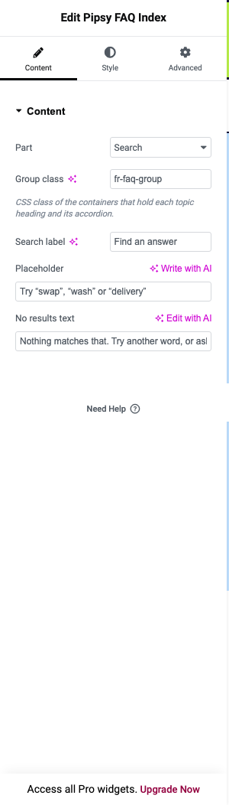
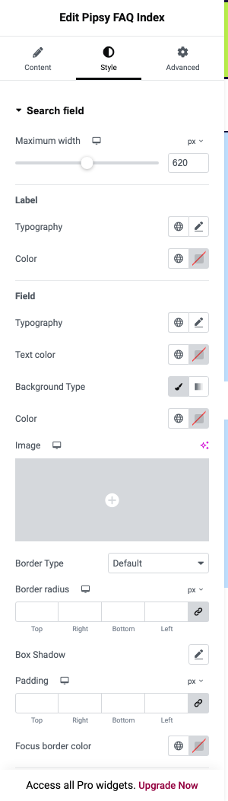

# More Pipsy Widgets

This page covers the other Pipsy widgets. For the three largest ones, see [Forecast Wardrobe](pipsy-forecast-wardrobe.md), [Word Swap](pipsy-word-swap.md) and [Set Builder](pipsy-set-builder.md); for the Size Finder, see [Sizes & Size Finder](../woocommerce/sizes-and-size-finder.md#size-finder).

Widgets with a **Header** section share the same Eyebrow, Heading, Heading tag and Introduction controls, described in [Pipsy Widgets](pipsy-widgets.md#shared-controls).

## Pipsy Gift Finder

Three short questions answered with choice chips: **who it is for**, **budget** and **occasion**. The button then opens the product tag of the occasion, filtered by the sizes and the maximum price chosen. There is no separate results page. Without JavaScript the button still opens every gift.

It needs:

* Sizes with slugs you can name, see [Sizes & Size Finder](../woocommerce/sizes-and-size-finder.md).
* One **product tag** per occasion (the demo has _Birthday_, _New baby_ and others) and one tag for all gifts (_Gift_).

### Content

| Section | Controls |
| --- | --- |
| **Panel** | Title, Title tag, Introduction |
| **Question 1: who is it for** | **Question**, and a list of answers. Each answer has a **Label**, a **Height hint** and **Size slugs** (comma-separated slugs of the size terms this answer shows, for example `2-3y,3-4y,4-5y`) |
| **Question 2: budget** | **Question**, and a list of answers. Each answer has a **Label** and a **Maximum price** (leave empty for any price) |
| **Question 3: occasion** | **Question**, and a list of answers. Each answer has a **Label** and a **Product tag slug**. **All gifts tag slug** (default `gift`) is used until an occasion is picked |
| **Button and note** | **Button**, **Summary** (read out after each choice; placeholders `{who}`, `{budget}`, `{occasion}`; default "Gifts for {who}, {budget}, {occasion}."), **Not chosen yet**, **Note** |

### Style

| Section | Controls |
| --- | --- |
| **Panel** | Gap between parts, text alignment |
| **Choice chips** | Gap, padding, border radius, border width, background, text color |
| **Result** | Color |
| **Button** | Full width, padding, border radius, background, text color |

## Pipsy FAQ Index

The search field and the topic list of a questions page. It reads the page's FAQ groups (containers with the CSS class set in **Group class**, each holding a heading and a Kitify Accordion), counts their questions, filters them by topic and by the search text, and reports the result. See [About, Contact & FAQs](../pages/help-pages.md#faqs).

Place one widget with the **Search** part in the page header and one with the **Topics** part in the sidebar; both work with the same groups.

<figure><figcaption>
Content tab
</figcaption></figure>

### Content

| Control | What it does | Default |
| --- | --- | --- |
| **Part** | Search or Topics | Search |
| **Group class** | CSS class of the FAQ group containers | `fr-faq-group` |
| **Search label**, **Placeholder** | Search part | "Find an answer" |
| **No results text** | Shown when nothing matches | |
| **Topics label**, **All topics label** | Topics part | "Browse by topic", "All questions" |
| **Show counts** | Number of questions next to each topic | On |
| **Note heading**, **Note text** | An optional note under the topics | |
| **Stay in view while scrolling** | Keeps the topic list sticky | On |


The default **Note text** describes Pipsy as a concept store. Change or empty it on your site.


### Style

| Section | Controls |
| --- | --- |
| **Search field** | Maximum width; label typography and color; field text color and focus border color; result line color |
| **Topics label** | Typography and color |
| **Topic buttons** | Gap, padding, border radius; Normal, Hover and Selected colors (text, count, background, border) |
| **Note** | Top spacing, divider color, heading and text typography and colors |

<figure><figcaption>
Style tab
</figcaption></figure>

## Product page widgets

### Pipsy Product Questions

Numbered questions with a category, a toggle and an optional link to another part of the page. It works without JavaScript; the script only keeps one answer open at a time when that option is on.

| Tab | Controls |
| --- | --- |
| **Content > Header** | Eyebrow, Heading, Heading tag, Introduction |
| **Content > Questions** | **Context label**, **Show product name**, **Open the first question**, **One answer open at a time**, and the **Questions** repeater: Question, Answer, Category, Link label, Link |
| **Style > Question** | Divider color, open background, open border radius, padding, question typography and color, number typography, category typography, number and category color |
| **Style > Toggle** | Size; icon color, background and border color for the Normal, Hover and Open states |

The questions are the same on every product, because they are written in the template. Use them for store-wide answers (sizing, swaps, returns).

### Pipsy Product Story

See [Product Story](../woocommerce/product-story.md).

### Pipsy Product Chapters

A sticky row of links to the sections of the product page, and an optional selection bar (image, selected options, price, Add to cart) that appears at the bottom of the screen once the main Add to cart form has scrolled out of view. Links whose target is missing or empty are hidden.

| Tab | Controls |
| --- | --- |
| **Content > Chapters** | **Accessible name**, and the **Links** repeater: **Label** and **Section ID** (the CSS ID of the container to jump to, without `#`) |
| **Content > Selection bar** | **Show selection bar**, **Edit link label**, **Label before a choice is made** |
| **Style > Chapters bar** | Gap, alignment; link color and underline color per state |
| **Style > Selection bar** | Maximum width; title, options and price typography; button border radius and colors per state |

Place it directly inside the container that holds the sections it links to, so it stays sticky for their whole length. The demo uses it without links, only for the buy bar.

## Editorial widgets

These widgets are included for building extra landing sections. They are not placed on a demo page, and their default texts are placeholders.

### Pipsy Hero Slider

Hero slides with an eyebrow, heading, description, two buttons, an image and an optional featured product.

| Tab | Controls |
| --- | --- |
| **Content > Slides** | Per slide: Image, Image on mobile (optional portrait crop for screens up to 767px), Eyebrow, Heading, Description, Primary and Secondary button label and URL, Image label, Featured product (with fallback name, image and link), Featured product label, caption and link label |
| **Content > Slider settings** | **Layout** (Copy beside image, Full-screen image, Banner), Autoplay, Autoplay delay, Loop, Entrance animation, **Pin while scrolling** (the hero stays in place and the next section slides over it; sections below need their own background), Minimum height |
| **Style** | Section & layout, Eyebrow, Heading, Description, Buttons (Normal and Hover / focus), Media, Image label, Featured product, Slider navigation |

### Pipsy Product Spotlight

One product on a stage, with a switch between its cut-out image and a second, lifestyle image.

| Tab | Controls |
| --- | --- |
| **Content > Product** | Product, Name override, Category label, Silhouette image (a cut-out on a transparent background works best; defaults to the product image), Room image, Room image on mobile, the two switch button labels, Link label, **Layout** (Stage or Studio), Product name behind the object, Link override |
| **Style** | Stage (height, padding, text color, stage colour, silhouette width, image overlay), View switch, Link |

### Pipsy Image Accordion

A large image beside a numbered accordion. Opening an item shows its image and caption; one item is always open.

| Tab | Controls |
| --- | --- |
| **Content > Items** | Per item: Title, Text, Note, Image, Image caption, Button label, Button link. Then Show numbers, **Layout** (List in a card, or Editorial), Note beside the image caption |
| **Style** | Layout (gap, image aspect ratio and radius, caption), Accordion card, Item title (Normal, Hover, Open), Button |

### Pipsy Scene Tabs

A rounded panel with a header and a row of pill tabs beside a large image. Each tab brings its own heading, text, link, image, caption and the panel's background and text colors, so choosing a tab recolors the whole panel.

| Tab | Controls |
| --- | --- |
| **Content > Scenes** | Per scene: Tab label, Heading, Text, Link label, Link, Image, Image on mobile, Caption on the image, Panel background, Panel text, Swatch 1–3. Then Show swatches, Image side (Left or Right), Note, Tabs accessible name |
| **Style** | Panel (minimum height, copy column width, default colors, radius, padding, colour change duration), Tabs (Normal, Hover, Selected, focus outline), Link, Image caption |

### Pipsy Detail Lens

A wide image with a round magnifier in the middle, a label and a "Look closer" slider that sets the magnification. Good for fabric and print close-ups.

| Tab | Controls |
| --- | --- |
| **Content > Lens** | Image, Image in the lens (leave empty to magnify the main image), Label, Caption in the lens, Zoom label, Minimum zoom, Maximum zoom, Starting zoom, Note |
| **Style** | Image (height, focus), Lens (size, position, caption), Label, Zoom control, Note |
