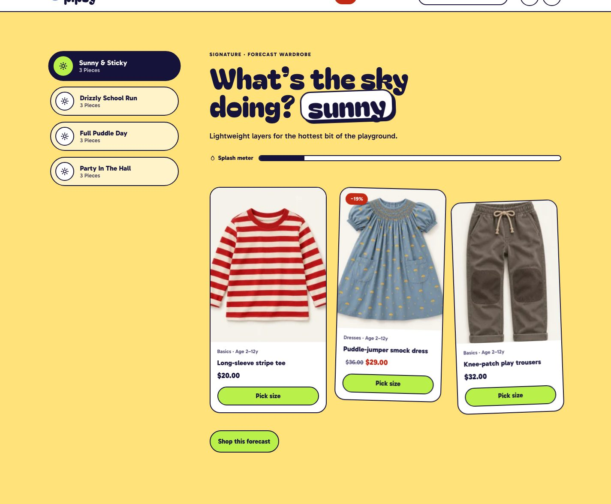
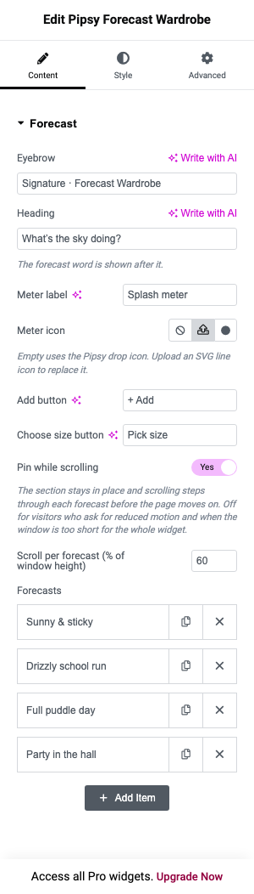
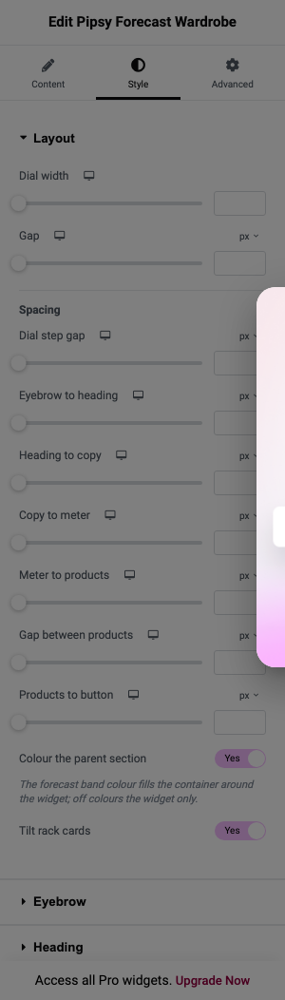

# Pipsy Forecast Wardrobe

A weather dial for dressing kids. Each **forecast** (for example "Sunny & Sticky" or "Full Puddle Day") is a step of the dial. Choosing a forecast swaps the band color, the highlighted word in the heading, the copy, a "splash meter" and a tilted rack of three products.

<figure><figcaption>
Forecast Wardrobe on the home page
</figcaption></figure>

Shoppers change the forecast with a click or the arrow keys. With **Pin while scrolling** on, the section stays in place under the header while the visitor scrolls through every forecast, then the page moves on. Pinning is skipped for visitors who ask for reduced motion and when the window is too short for the whole widget. Every forecast's products are in the page, so the content is readable without JavaScript.

## Content

<figure><figcaption>
Content tab
</figcaption></figure>

### Forecast

| Control | What it does |
| --- | --- |
| **Eyebrow** | Small label above the heading |
| **Heading** | The heading. The highlighted word of the current forecast is shown after it |
| **Meter label** | Label of the meter, "Splash meter" in the demo |
| **Meter icon** | Empty uses the Pipsy drop icon. Upload an SVG line icon to replace it |
| **Add button** | Label of the add button on simple products |
| **Choose size button** | Label of the button on products that need a size, "Pick size" in the demo |
| **Pin while scrolling** | Holds the section while scrolling steps through each forecast |
| **Scroll per forecast (% of window height)** | How much scrolling moves to the next forecast |
| **Forecasts** | The steps of the dial, see below |

### Each forecast

| Control | What it does |
| --- | --- |
| **Dial label** | Name of the step, for example "Drizzly School Run" |
| **Icon** | Empty uses the Pipsy sun icon. Upload an SVG line icon to replace it |
| **Emoji (fallback)** | Shown only when no icon is chosen |
| **Highlighted word** | The word shown after the heading, for example "sunny" |
| **Copy** | One line under the heading |
| **Splash meter (%)** | How far the meter is filled |
| **Band colour** | The color of the section for this forecast |
| **Product IDs** | Three products, comma separated, for example `12, 34, 56` |
| **Button** / **Button link** | The button under the products, for example a link to a product tag |


To find a product ID, go to **Products** and hover the product: the ID appears under its name.


## Style

<figure><figcaption>
Style tab
</figcaption></figure>

| Section | Controls |
| --- | --- |
| **Layout** | Dial width, gap, dial step gap, the spacing between each part (eyebrow to heading, heading to copy, copy to meter, meter to products, products to button), gap between products, **Colour the parent section**, **Tilt rack cards** |
| **Eyebrow**, **Heading**, **Copy** | Typography and color of each text |
| **Highlighted word** | Color |
| **Dial steps** | Background, text color, border radius, padding |
| **Dial icons** | Circle size, icon size, border width, border radius, icon color, background, border color |
| **Splash meter** | Icon color, icon size, track color, fill color, height |
| **Rack cards** | Name typography, name color, price color |
| **Buttons** | Background, text color |

**Colour the parent section** paints the whole container with the forecast's **Band colour**, so the band changes color edge to edge. Turn it off to keep the color inside the widget.

The default spacing grows with the window height, so the pinned section still fits on short screens. If you set your own spacing, check the section on a laptop-size window.
