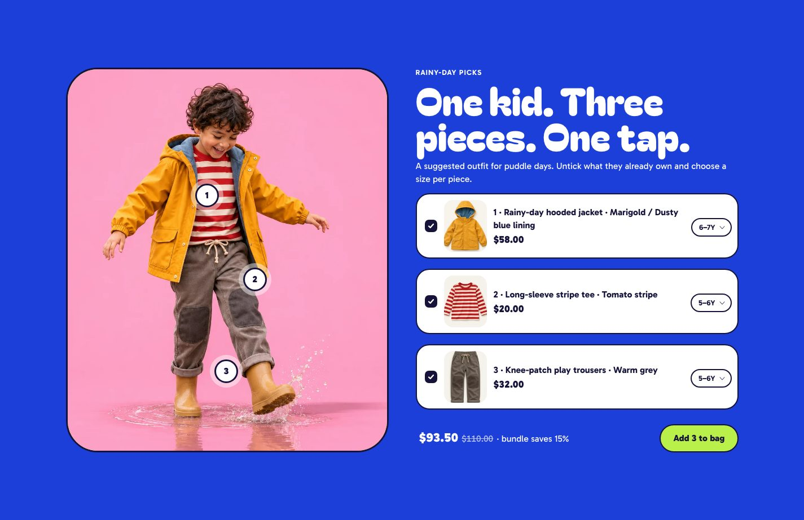
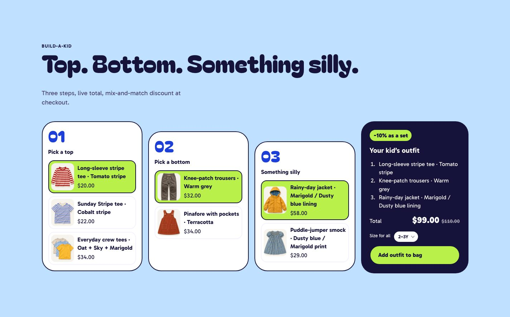
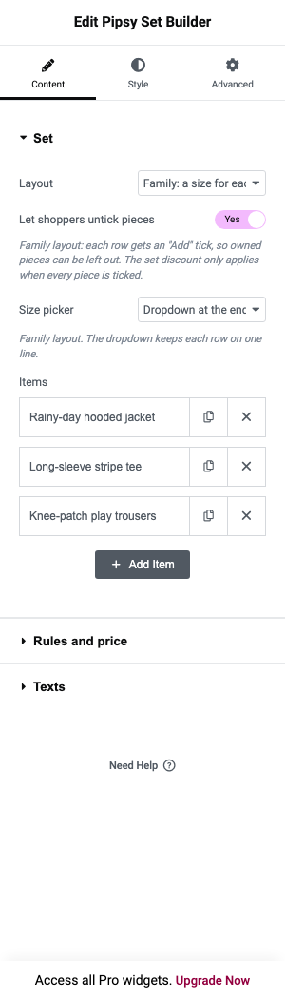
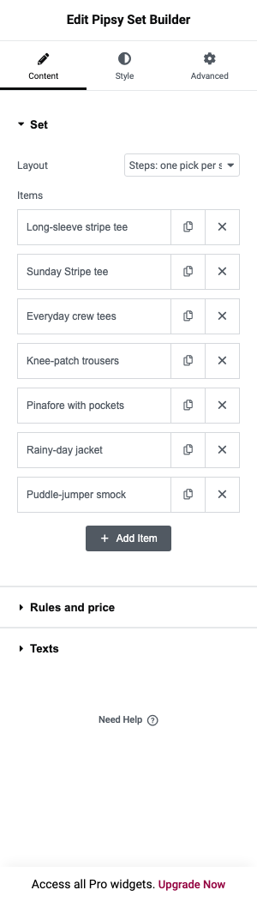
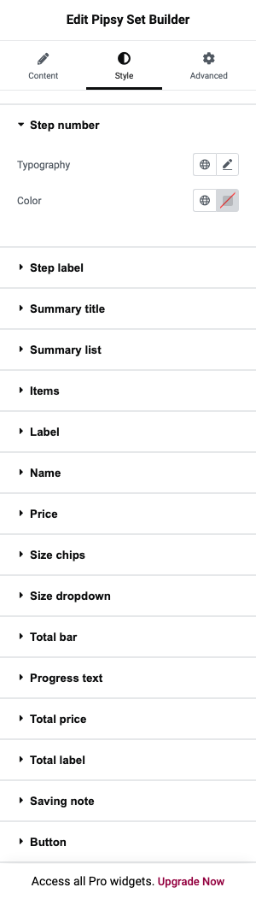

# Pipsy Set Builder

The Set Builder adds several products to the bag in one go, each in a chosen size. It can give a discount while the whole set is in the cart.

It has three layouts:

| Layout | How it works | Demo |
| --- | --- | --- |
| **Family** | One row per product (photo, label, name, price, sizes) and a total row with one add button. With **Size picker: Dropdown** each row is a compact line. | Home: Spot the Fit |
| **Pick** | Tiles the shopper toggles, a progress bar ("2 of 3 picked"), one size for the whole set, and the set price with the discount once enough items are picked. | – |
| **Steps** | One card per step ("01 Pick a top"), one choice per step, and a summary with the discount badge, the picked names, the total, one size for the outfit and the add button. | Home: Build-a-Kid |

<figure><figcaption>
Family layout with the dropdown size picker (Spot the Fit)
</figcaption></figure>

<figure><figcaption>
Steps layout (Build-a-Kid)
</figcaption></figure>

## Requirements

* Each item must be a **variable product with a Size attribute** (**Products > Attributes > Size**). See [Sizes & Size Finder](../woocommerce/sizes-and-size-finder.md).
* In the Pick and Steps layouts the shopper chooses one size for the whole set. The size list only offers sizes that every product (or every step) can be bought in.

## Content

<figure><figcaption>
Content tab
</figcaption></figure>

### Set

| Control | What it does |
| --- | --- |
| **Layout** | Family, Pick or Steps |
| **Let shoppers untick pieces** | Family layout: each row gets an "Add" tick, so owned pieces can be left out. The set discount only applies when every piece is ticked |
| **Size picker** | Family layout: size chips or a dropdown. The dropdown keeps each row on one line |
| **Items** | The products of the set, see below |

Each item of the **Items** repeater:

| Control | What it does |
| --- | --- |
| **Product ID** | A variable product with a Size attribute |
| **Label** | Family layout: who it is for, for example "Baby" or "Grown-up" |
| **Short name** | Leave empty to use the product name |
| **Sizes shown** | Family layout: size slugs, comma separated (`3-6m, 6-9m, 9-12m`). Leave empty to show every size in stock |
| **Selected size** | Family layout: slug of the size chosen at first. Empty picks the middle size |
| **Step** | Steps layout: items with the same step text form one single-choice step, in order of first use (`01 Pick a top`) |
| **Picked at first** | Pick layout only |

<figure><figcaption>
Content tab of the Build-a-Kid set (Steps layout)
</figcaption></figure>

### Rules and price

| Control | What it does | Default |
| --- | --- | --- |
| **Items in a set** | Pick layout: how many items make the set. The Family layout always adds every item | 3 |
| **Set discount (%)** | Taken off each item in the cart while the whole set is there. `0` adds no discount | 0 |

### Texts

Every text of the widget is a control. Placeholders in curly brackets are replaced on the page.

| Control | Layout | Placeholders | Default |
| --- | --- | --- | --- |
| **Total label** | Family | `{count}` | "Family set, {count} pieces" |
| **Saving note** | All | `{discount}` | Empty. Example: "· bundle saves {discount}%" |
| **Size label** | All | | "Size" |
| **Progress** | Pick | `{picked}`, `{needed}` | "{picked} of {needed} picked" |
| **Hint while picking** | Pick | `{left}`, `{discount}` | "Add {left} more to unlock {discount}% off" |
| **Hint when complete** | Pick | `{discount}` | "Set complete: {discount}% off" |
| **Summary title** | Steps | | "Your kid’s outfit" |
| **Discount badge** | Steps | `{discount}` | "−{discount}% as a set". Empty hides it |
| **Total word** | Steps | | "Total" |
| **Button**, **Button icon** | All | | "Add family set", icon on |
| **Added message** | All | | "Added to your bag." |
| **Error message** | All | `{name}`, `{size}` | "{name} in {size} could not be added. Try another size." |
| **Size not available** | Pick | `{size}` | "Not in {size}" |

## Style

The Style tab has one section per part of the widget. Sections that belong to another layout have no effect on the layout you chose.

<figure><figcaption>
Style tab
</figcaption></figure>

| Section | Controls |
| --- | --- |
| **Step card** | Steps layout. Gap between cards, stagger (each card drops by), gap inside, and the card box |
| **Step number**, **Step label** | Typography and color |
| **Step choice** | Gap between choices, photo width, padding, border radius, border width, name typography, price typography |
| **Summary** | Width, gap inside, text color; discount badge background, text color, padding and border radius |
| **Summary title**, **Summary list** | Typography and color |
| **Items** | Columns (Pick layout), gap, photo width (Family layout), photo radius, picked border color, check mark color, tick color, focus ring color |
| **Label**, **Name**, **Price** | Typography and color of the texts of each item |
| **Size chips** | Gap, height, padding, border radius, border width |
| **Size dropdown** | Height, padding, border radius, border width |
| **Total bar** | Gap, space above, done step color |
| **Progress text**, **Total price**, **Total label**, **Saving note** | Typography and color |
| **Button** | Height, padding, border radius, background, text color |
| **Status message** | Typography and color of the "Added to your bag." and error messages |

## How the set discount works

* The widget marks the items it adds as one set. While all the items of that set are in the cart, each of them is sold at the discounted price.
* If the shopper removes one item of the set, the others go back to their full price.
* The discount only applies to the products, percentage and set size saved in the widget. It can't be changed from the browser.
* In the cart, each item of the set shows a line "Set: 10% off with the full set" (with your percentage) and its lower price.
* The discount changes the item price, so it is not a coupon. If you also run WooCommerce coupons, test how they combine with a set before you launch a promotion.

## Using it with hotspots

In the demo's "Spot the Fit" section, a **Kitify Hotspots** widget shows numbered pins on a photo, and a Set Builder in the Family layout lists the same products beside it. They are two separate widgets: keep the order of the hotspots and the items the same so the numbers match.


Items that are not variable products with a Size attribute are skipped. When no item is valid, the widget shows the message "Add variable products with a Size attribute to the Items list." in the Elementor editor and nothing on the site.

