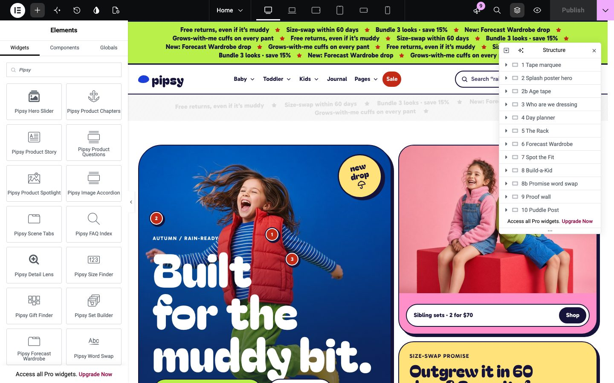

# Pipsy Widgets

On top of the Elementor and Kitify widgets, Pipsy adds 14 widgets of its own. They are part of the **Pipsy Core** plugin, so keep that plugin active. Find them in the Elementor panel by searching for **Pipsy**.

<figure><figcaption>
Search "Pipsy" in the Elementor panel
</figcaption></figure>

Every Pipsy widget has a **Content** tab for its texts and items, and a **Style** tab for the colors, spacing, borders and radius of each part. Default colors and fonts come from [Theme Options](../theme-options/colors-and-typography.md). The background, padding and width of a section are set on the container around the widget, not in the widget.

## Shopping widgets

| Widget | What it does | Used in the demo |
| --- | --- | --- |
| [**Pipsy Size Finder**](../woocommerce/sizes-and-size-finder.md#size-finder) | One height field that names the size that fits and links to the shop filtered by that size. | Product template |
| [**Pipsy Gift Finder**](more-pipsy-widgets.md#pipsy-gift-finder) | Three questions (who it is for, budget, occasion) answered with chips, then one link to the matching products. | – |
| [**Pipsy Set Builder**](pipsy-set-builder.md) | Several products added to the bag in one go, each in a chosen size, with an optional set discount. Three layouts. | Home: Spot the Fit, Build-a-Kid |

## Home page widgets

| Widget | What it does | Used in the demo |
| --- | --- | --- |
| [**Pipsy Forecast Wardrobe**](pipsy-forecast-wardrobe.md) | A weather dial that swaps the band color, a highlighted word, the copy, a meter and three products. | Home |
| [**Pipsy Word Swap**](pipsy-word-swap.md) | Photo cards scroll between two giant words that change with each card. | Home |
| [**Pipsy Hero Slider**](more-pipsy-widgets.md#pipsy-hero-slider) | Hero slides with heading, text, buttons, image and a featured product. | – |
| [**Pipsy Product Spotlight**](more-pipsy-widgets.md#pipsy-product-spotlight) | One product on a stage, with a switch between its cut-out image and a lifestyle image. | – |
| [**Pipsy Image Accordion**](more-pipsy-widgets.md#pipsy-image-accordion) | A large image beside a numbered accordion; opening an item changes the image. | – |
| [**Pipsy Scene Tabs**](more-pipsy-widgets.md#pipsy-scene-tabs) | A panel with pill tabs; each tab has its own text, image and panel colors. | – |
| [**Pipsy Detail Lens**](more-pipsy-widgets.md#pipsy-detail-lens) | A wide image with a round magnifier and a "Look closer" slider. | – |

## Product page widgets

These widgets are meant for the **Pipsy — Product** template. They read the current product, so one template works for every product.

| Widget | What it does | Used in the demo |
| --- | --- | --- |
| [**Pipsy Product Story**](../woocommerce/product-story.md) | The product's story from **Product data > Editorial**. | Product template |
| [**Pipsy Product Questions**](more-pipsy-widgets.md#pipsy-product-questions) | Numbered questions with a category and an optional link. | Product template |
| [**Pipsy Product Chapters**](more-pipsy-widgets.md#pipsy-product-chapters) | Sticky links to the sections of the product page, plus a buy bar. | Product template (buy bar only) |

## Page widgets

| Widget | What it does | Used in the demo |
| --- | --- | --- |
| [**Pipsy FAQ Index**](more-pipsy-widgets.md#pipsy-faq-index) | Search field and topic list for a FAQ page. | FAQs page |


The widgets marked "–" are not placed on a demo page. Their default texts and images are placeholders: add your own content after you drop them on a page.


## Shared controls

Many Pipsy widgets start with the same **Header** section:

| Tab | Controls |
| --- | --- |
| **Content > Header** | Eyebrow, Heading, Heading tag, Introduction |
| **Style > Header** | Layout, gap, bottom spacing; typography, color and spacing of the eyebrow, heading and introduction; maximum width of the introduction |

Leave a header field empty to hide it, for example when you prefer separate Heading widgets above the widget.
