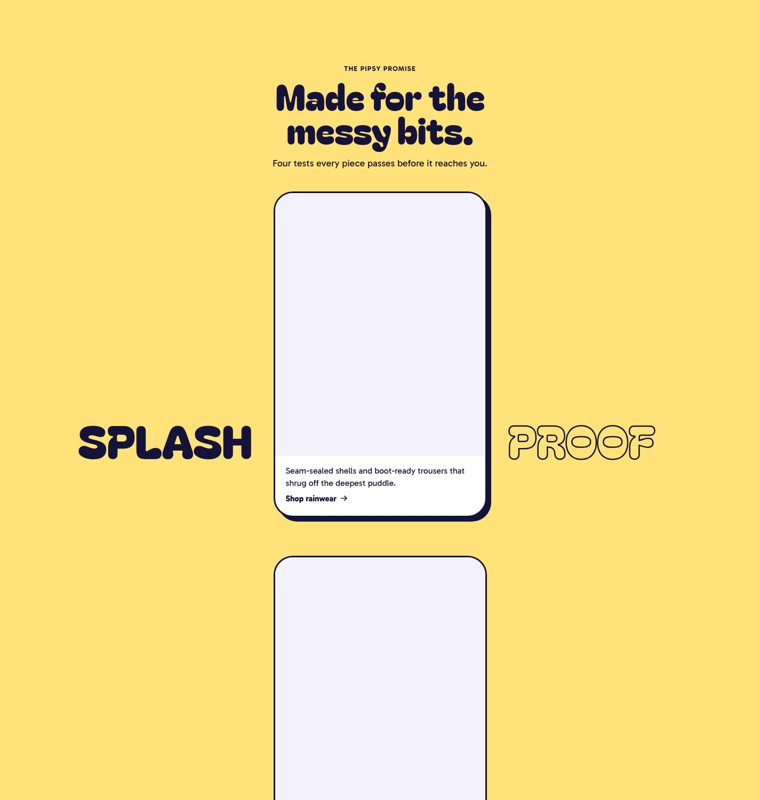
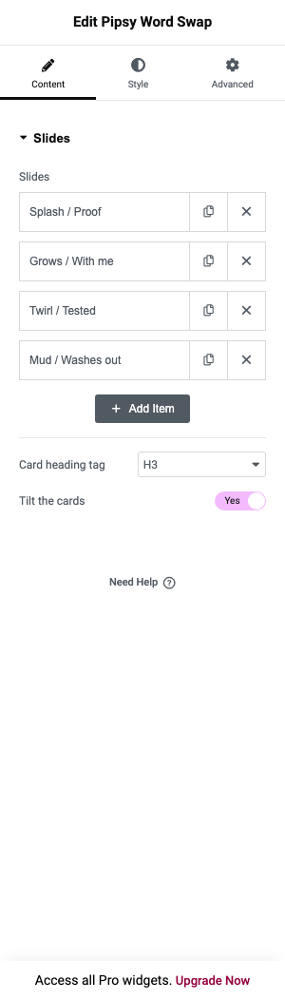
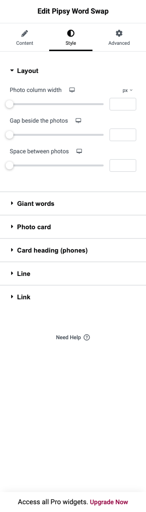

# Pipsy Word Swap

A column of photo cards scrolls through the middle of the section while two giant words stay in view on either side. When a card reaches the centre of the screen, its word pair slides in, for example "SPLASH / PROOF".

<figure><figcaption>
Word Swap on the home page
</figcaption></figure>

Each card carries its own heading, line and link, so the giant words are decorative and hidden from screen readers. Phones get one column with the heading on each photo.

## Content

<figure><figcaption>
Content tab
</figcaption></figure>

### Slides

Each slide of the **Slides** repeater has:

| Control | What it does |
| --- | --- |
| **Photo** | The photo of the card |
| **Left word** / **Right word** | The giant word pair shown while this card is in the centre |
| **Line** | A sentence under the photo |
| **Link text** / **Link** | The link of the card |
| **Accent** | The accent color of this slide |

Below the repeater:

| Control | What it does |
| --- | --- |
| **Card heading tag** | The HTML tag of the card headings |
| **Tilt the cards** | Gives each card a slight rotation |

Keep the words short (one word each, up to about seven letters) so they fit beside the photos on laptops.

## Style

<figure><figcaption>
Style tab
</figcaption></figure>

| Section | Controls |
| --- | --- |
| **Layout** | Photo column width, gap beside the photos, space between photos, **Words: space for the sticky header** |
| **Giant words** | Fill color, outline color, outline width, left word alignment, right word alignment |
| **Photo card** | Photo ratio, gap inside, text padding |
| **Card heading (phones)** | Text color, padding, border radius |
| **Line** | Typography and color of the sentence under the photo |
| **Link** | Text color, focus ring color |

**Words: space for the sticky header** moves the giant words down so they are not covered by the sticky header. Increase it if your header is taller than the demo's.
