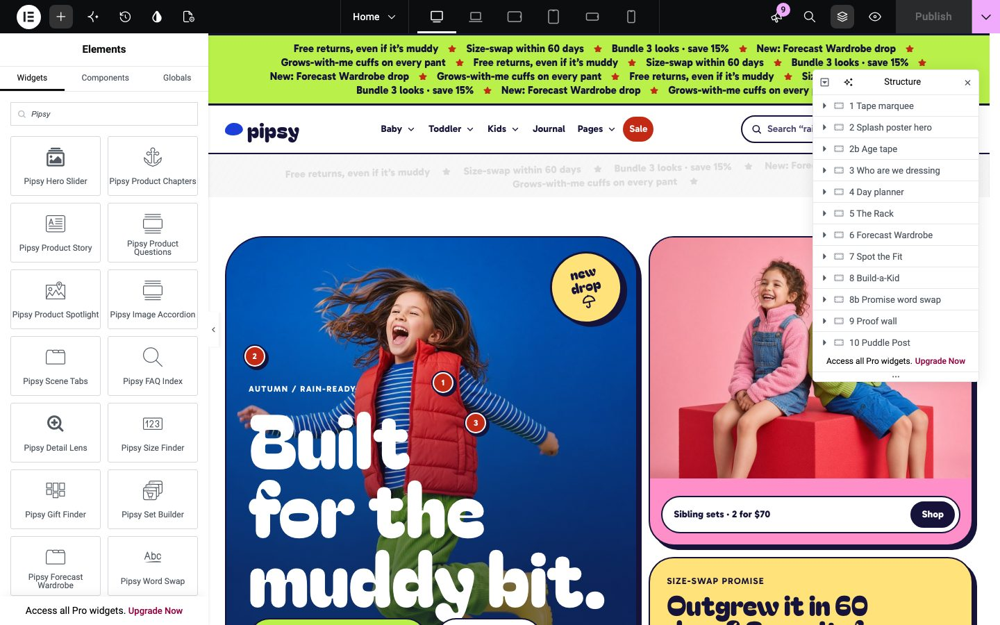

# What is Elementor

Elementor is a drag-and-drop page builder for WordPress. Every page of the Pipsy demo, as well as the header, footer, shop, product and Journal templates, is built with Elementor, so you can edit them visually and see your changes live.

To edit a page, open it and click **Edit with Elementor** in the admin bar, or go to **Pages**, hover the page and click **Edit with Elementor**.

<figure><figcaption>
The Elementor editor
</figcaption></figure>

Pipsy works with the free version of Elementor. You don't need Elementor Pro.

A few tips when editing Pipsy pages:

* Section backgrounds, padding, margins and gaps are set on each **container** in the **Style** and **Advanced** tabs, with separate values for desktop, tablet and mobile.
* Use the **Global Colors** and **Global Fonts** in the color and font pickers. They follow your [Theme Options](../theme-options/colors-and-typography.md).
* Open the **Structure** panel to find a section by name.
* If a page looks unstyled after an update, go to **Elementor > Tools** and click **Regenerate Files & Data**.

Learn more in the [Elementor documentation](https://elementor.com/help/).
