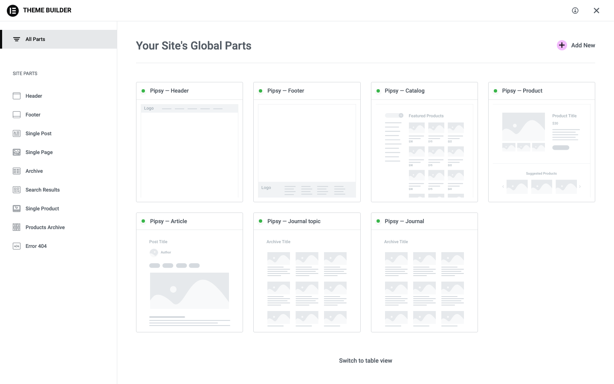
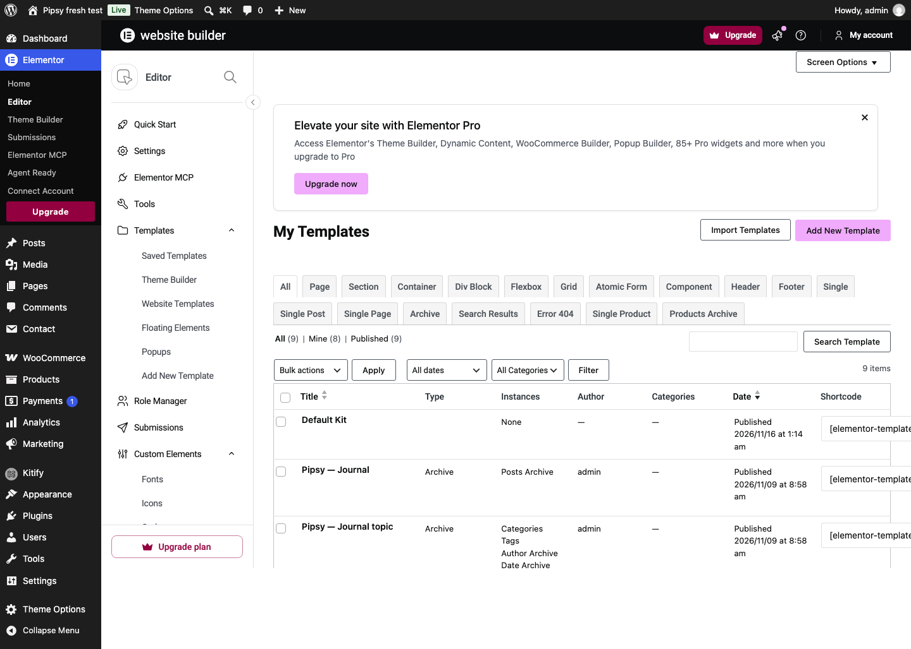

# What is Kitify

Kitify is our extension for Elementor, included with Pipsy. It gives you professional tools that speed up your workflow and design:

1. **Theme Builder** – design the header, footer, shop pages, product pages, blog and other templates with Elementor, and choose where each template is shown.
2. **WooCommerce widgets** – products, categories, product images, price, add to cart, mini cart, wishlist and more.
3. **Site widgets** – menus, search, subscribe form, text marquee, hotspots, accordion, tabs, testimonials, posts and many others.

Pipsy uses these Kitify templates in the demo:

| Template | Type | Shown on |
| --- | --- | --- |
| Pipsy — Header | Header | Entire site |
| Pipsy — Footer | Footer | Entire site |
| Pipsy — Catalog | Products Archive | Shop, product categories and tags |
| Pipsy — Catalog promo | Section | Inside the product grid of the catalog |
| Pipsy — Product | Single Product | All products |
| Pipsy — Journal | Archive | Blog index |
| Pipsy — Journal topic | Archive | Category, tag, author and date archives |
| Pipsy — Article | Single Post | All posts |

Find them in **Kitify > Theme Builder**.

<figure><figcaption>
Kitify > Theme Builder
</figcaption></figure>

The same templates are listed in **Templates** in the admin menu, where you can also export and import them.

<figure><figcaption>
Templates
</figcaption></figure>

## Display conditions

Each template has **Display Conditions** that decide where it is used. Open the template in Elementor, click the arrow next to **Publish** and choose **Display Conditions**. For example, you can create a second Single Product template and show it only for one product category.

## Kitify settings

**Kitify > Settings** holds the integrations used by the widgets, such as the MailChimp API key for the Subscribe Form. **Kitify > Adobe Fonts** connects an Adobe Fonts project.


[Kitify documentation](https://docs.novaworks.net/kitify)

