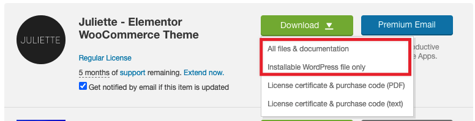

# Step 1 - Download Theme

There are two ways you can install the **Pipsy** theme: via the WordPress dashboard or via FTP. Before you can install **Pipsy**, please download the theme files from ThemeForest first.

If this is your first time downloading the theme from ThemeForest, we recommend downloading the full theme package to receive the additional files such as the companion plugins and the licensing files. If you've already downloaded the full package, you can just use the installable WordPress file.

<figure><figcaption></figcaption></figure>

**Step 1** – Log in to your ThemeForest account, navigate to your _Downloads_ tab and locate your **Pipsy** purchase.

**Step 2** – Click the _Download_ button and choose either **Installable WordPress file only**, which is just the installable theme file, or **All files & documentation**, which is the full **Pipsy** package.
