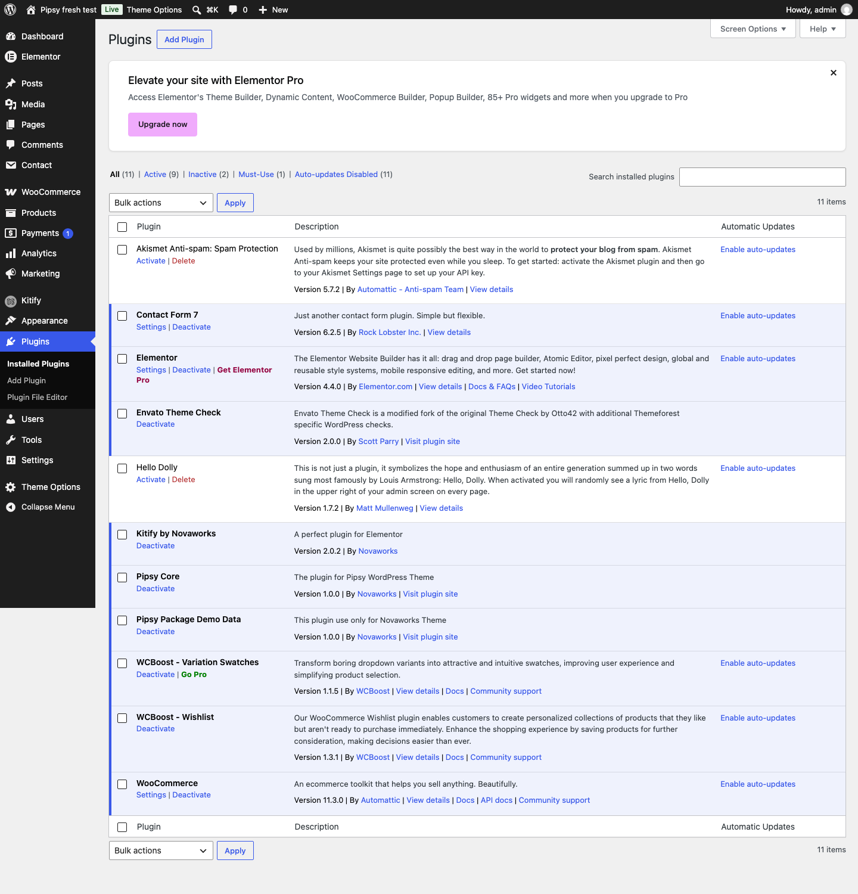

# Step 3 - Install Plugins

After you activate the Pipsy theme, you'll see a notification at the top of the page saying that the theme needs some plugins to function properly.

## Required Plugins

Required plugins must be installed and activated at all times for **Pipsy** to work properly. The **Pipsy** theme **requires** the following plugins:

* [WooCommerce](https://wordpress.org/plugins/woocommerce/): a powerful, extendable eCommerce plugin that helps you sell anything.
* [Elementor](https://wordpress.org/plugins/elementor/): the page builder used for every page, header and footer of the demo. The free version is enough.
* **Kitify** (version 2.0.2 or higher): our Elementor extension. It adds the Theme Builder (header, footer, shop, product and blog templates) and the WooCommerce widgets used by Pipsy.
* **Pipsy Core**: the theme's core plugin. It adds Theme Options, the mega menu, the product story fields and the products filter.

## Recommended Plugins

Recommended plugins are used in our demo and are fully integrated with **Pipsy**. You can skip them if you're not going to use their features. The **Pipsy** theme **recommends** the following plugins:

* **Pipsy Package Demo Data**: the one-click demo importer. You can deactivate it after importing the demo.
* [WCBoost – Variation Swatches](https://wordpress.org/plugins/wcboost-variation-swatches/): shows colors and other attributes as swatches on product cards, quick view and the product page.
* [WCBoost – Wishlist](https://wordpress.org/plugins/wcboost-wishlist/): lets shoppers save products to a wishlist. See [Wishlist](../woocommerce/wishlist.md).
* [Contact Form 7](https://wordpress.org/plugins/contact-form-7/): used for the form on the Contact page.

**Pipsy** adds its own styles to these plugins so they match the theme design.

## Install These Plugins

**Step 1** - From the WordPress admin, navigate to **Appearance > Install Plugins**. Here you'll find the required and recommended plugins of **Pipsy**.

**Step 2** - Select the plugins, choose **Install** from the bulk action menu and click **Apply**. You can also click **Install** below each plugin name.

**Step 3** - After installing, activate the plugins. Kitify, Pipsy Core and Pipsy Package Demo Data are downloaded from the Novaworks server (`assets.novaworks.net`), so your site needs to be able to make outgoing connections.

When everything is installed and active, the **Install Plugins** menu item disappears and **Plugins > Installed Plugins** looks like this:

<figure><figcaption>
The eight plugins of the Pipsy demo
</figcaption></figure>

## Troubleshooting

1. **Failed to install/activate some plugins.**

   Sometimes the download fails on some hosts and some files are missing, so the plugin can't be activated. Navigate to **Plugins > Installed Plugins**, delete those plugins and install them again.
2. **The download from the Novaworks server fails.**

   Upload the plugins manually: go to **Plugins > Add New Plugin > Upload Plugin** and choose the ZIP files from the `plugins` folder of the full theme package.
3. **I can't find Appearance > Install Plugins.**

   The menu item is only shown while a required or recommended plugin is missing, inactive or outdated.
