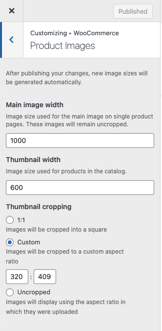

# Step 4 - Config Image Sizes

After installing the required plugins, check the product image sizes **before** importing the demo content, so the demo images are generated at the right size.

WooCommerce has settings for image sizes in **Appearance > Customize > WooCommerce > Product Images**.

<figure><figcaption></figcaption></figure>

<!-- TODO: confirm the image sizes used on the live demo (pipsy.ecomnius.com) and replace the suggested values below if they differ. -->

Suggested values for Pipsy:

* **Main image width**: 1100 px.
* **Thumbnail width**: 600 px.
* **Thumbnail cropping**: choose one ratio for the whole catalog so product cards line up in the grid. Choose _Uncropped_ only if all your product photos already share the same shape.

Pipsy also registers its own square size, `nova-image-square` (1100 × 1100 px), used by some widgets.


If you change image sizes after uploading images, regenerate the thumbnails with a plugin such as [Regenerate Thumbnails](https://wordpress.org/plugins/regenerate-thumbnails/).

