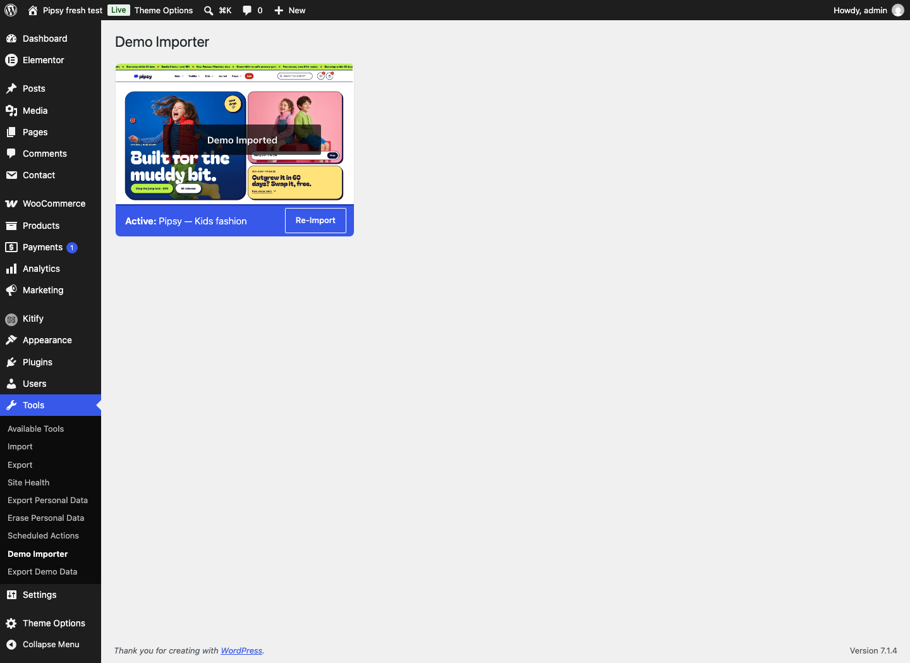

# Step 5 - Import Demo

The **Pipsy Package Demo Data** plugin imports the demo content in one click: pages, products with their sizes and colors, Journal articles, menus, header and footer templates, shop, product and Journal templates, and Theme Options.


**Create a full backup (files and database) before you import.** The importer adds content and changes settings, and there is no automatic rollback. We recommend importing on a fresh WordPress site.


## Before you start

* All required and recommended plugins are installed and active ([Step 3](step-3-install-plugins.md)). **Contact Form 7** must be active: the importer stops with a message if it is not, because the demo contains the contact form.
* The image sizes are set ([Step 4](step-4-config-image-sizes.md)).
* Your site can reach `pipsy.ecomnius.com`. The demo images are downloaded from the demo server during the import. If your host blocks outgoing requests, pages and products are imported without their images.

## Import

**Step 1** - Navigate to **Tools > Demo Importer**.

**Step 2** - Hover the **Pipsy — Kids fashion** demo and click **Import Demo**. A message asks **Import demo content?** and reminds you to create a backup. Confirm it to start.

**Step 3** - Keep the page open until the import is finished. It takes about 5 minutes on a fresh site, because images are downloaded one by one. When it is done, the card shows **Active: Pipsy — Kids fashion**.

<figure> Demo Importer after the import"><figcaption>
Tools > Demo Importer, after the demo has been imported
</figcaption></figure>

## Make the store visible to visitors


A new WooCommerce install starts in **Coming soon** mode. While it is on, you see the imported demo because you are logged in, but visitors who are not logged in see a "Coming soon" page instead.

To open the site, go to **WooCommerce > Settings > Site visibility**, choose **Live** and click **Save changes**.

This is the default behaviour of WooCommerce, not a setting of the Pipsy theme.


<!-- TODO: the importer card also prints a "Without Content" checkbox. The import script (assets/js/import.js) does not read it, so its behaviour is not documented here. Document it or remove the checkbox before release. -->

## What you get

| Content | Details |
| --- | --- |
| Pages | Home, Shop, Journal, About us, Contact us, FAQs, Order tracking, Wishlist, Cart, Checkout, My account |
| Products | 16 demo products with sizes, colors, categories and tags |
| Journal | 19 demo articles (a fresh WordPress site also keeps its own "Hello world!" post) |
| Menus | Pipsy — Main, Pipsy — Footer Shop, Pipsy — Footer Help, Pipsy — Footer Follow |
| Kitify templates | Pipsy — Header, Pipsy — Footer, Pipsy — Catalog, Pipsy — Catalog promo, Pipsy — Product, Pipsy — Journal, Pipsy — Journal topic, Pipsy — Article |
| Settings | Theme Options, Elementor Global Colors and Fonts, front page and posts page, WooCommerce pages, wishlist settings |

<figure><figcaption>
The imported home page
</figcaption></figure>

Links and email addresses in the demo content are rewritten to your own domain during the import.


* The demo products, prices, sizes and reviews are illustrative only. Replace them with your real catalog before you open the store.
* Demo images are for preview only and are not licensed for use on your live site.
* The contact form and the newsletter forms don't send anything until you configure them. See [Site Footer](../layout/site-footer.md) and [Help pages](../pages/help-pages.md).


## Import again

After a first import the button changes to **Re-Import**. Use it if an import was interrupted. Create a backup first: content you changed since the first import can be overwritten.

## Troubleshooting

1. **The import stops or times out.** Increase `max_execution_time` and `memory_limit` (see [Requirements](../getting-started/requirements-for-pipsy.md)) and run the import again.
2. **Images are missing.** Your server could not download them from `pipsy.ecomnius.com`. Ask your host to allow outgoing HTTPS requests, then click **Re-Import**.
3. **Pages look unstyled after the import.** Go to **Elementor > Tools**, click **Regenerate Files & Data**, then clear any cache plugin.
4. **Visitors see a "Coming soon" page instead of the demo.** WooCommerce is still in Coming soon mode. Go to **WooCommerce > Settings > Site visibility**, choose **Live** and save. See [Make the store visible to visitors](#make-the-store-visible-to-visitors).
5. **The import stops with "Contact Form 7 must be installed and active".** Activate Contact Form 7 in **Plugins > Installed Plugins**, then start the import again.
6. **The home page is not shown on the front.** Go to **Settings > Reading**, choose **A static page**, and select _Home_ as the homepage and _Journal_ as the posts page.
