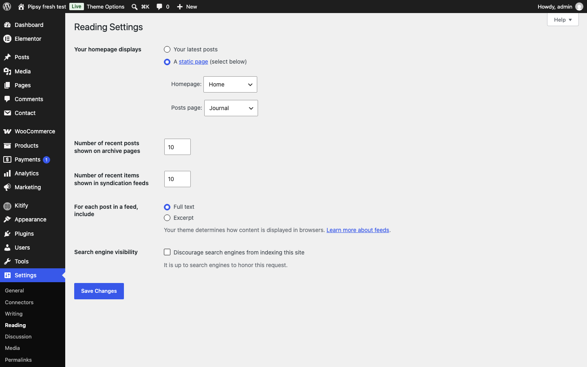
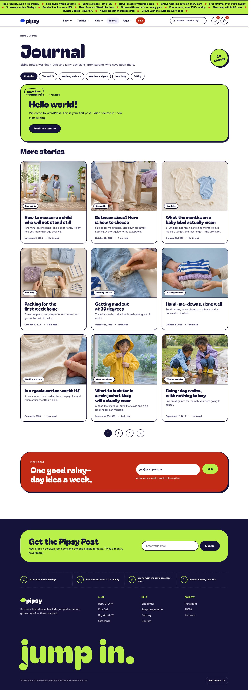
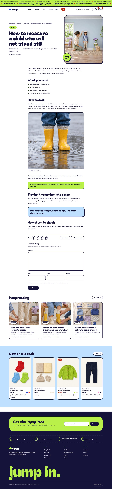

# Journal (Blog)

Pipsy calls its blog the **Journal**. The demo imports 19 articles and three **Kitify Theme Builder** templates:

| Template | Type | Shown on |
| --- | --- | --- |
| **Pipsy — Journal** | Archive | The blog index (the posts page) |
| **Pipsy — Journal topic** | Archive | Category, tag, author and date archives |
| **Pipsy — Article** | Single Post | Every post |

The posts page is the page called **Journal**, set in **Settings > Reading > Posts page**.

<figure> Reading"><figcaption>
Settings > Reading: Home as the homepage, Journal as the posts page
</figcaption></figure>

## Journal index

<figure><figcaption>
The Journal index
</figcaption></figure>

The index contains:

* The **title**, an intro and a **story count** sticker. The Heading widget of the sticker uses the placeholder `{post_count}`, replaced by the number of published stories.
* **Topic chips** – one Button per topic. Add, reorder or remove them in the editor, and link each one to its category.
* The **lead story** above the grid, marked "Start here". It is the newest post marked **Stick to the top of the blog**; when no post is sticky, it is the newest post. The grid leaves this post out.
* The **story grid** (Kitify Posts), 9 stories per page.
* A **newsletter** card, the same as on the home page.

### Choose the lead story

1. Go to **Posts** and click **Quick Edit** on the post.
2. Tick **Make this post sticky** and click **Update**.

## Topic archive

**Pipsy — Journal topic** shows the archive title (Kitify Archive Title), its description (Kitify Archive Description) and the story grid. Category descriptions are written in **Posts > Categories**.

## Article

<figure><figcaption>
A Journal article
</figcaption></figure>

The article template contains the topic (Kitify Post Terms), the title, the date, the **reading time**, the excerpt, the featured image, the content in a 720 px reading column, share links, a product rail, related stories and the comments.

* **Reading time** – a Heading widget with the placeholder `{reading_time}`. It is counted from the length of the post at 220 words a minute. The Kitify Posts widget also offers **Reading time** as a meta type for story cards.
* **Share links** – the shortcode `[pipsy_share label="Share"]`. From tablet up it shows the networks beside the label; on phones it shows one Share button that opens the device's share sheet. Choose the networks in **Theme Options > Social Share**.
* **Related stories** – other posts of the same topic.
* **Product rail** – a Kitify Woo Products widget; select it to choose the products shown under articles.

### Writing articles

Write posts in the regular WordPress editor (**Posts > Add Post**). Set a **featured image**, a **category** (the topic) and an **excerpt**: all three are used by the cards and the article header.

For a highlighted tip inside an article, select a paragraph block and choose the **Pipsy tip** style in the block's **Styles** panel.

## Edit the templates

1. Go to **Kitify > Theme Builder**.
2. Click **Pipsy — Journal**, **Pipsy — Journal topic** or **Pipsy — Article**.
3. Edit with Elementor and click **Publish**.

## Blog without the Kitify templates

If you remove these templates, the blog falls back to the theme's classic layout, and the options in **Theme Options > Blog** apply (sidebar, excerpt, read more button, pagination, author box, post navigation). The sidebar widgets are set in **Appearance > Widgets > Blog**.
