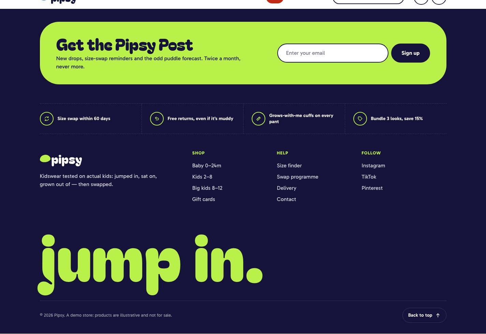
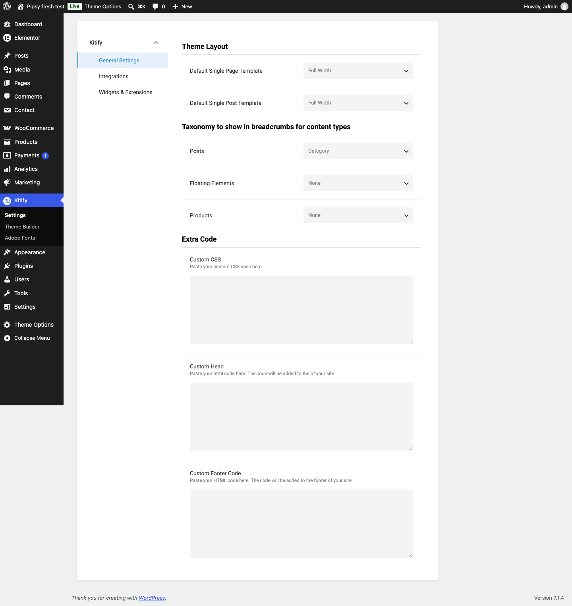

# Site Footer

The Pipsy footer is a **Kitify Theme Builder** template called **Pipsy — Footer**. It is imported with the demo and shown on the entire site.

<figure><figcaption>
The footer on desktop
</figcaption></figure>

It is a full-width dark band with:

* A Lime **sign-up card** with a newsletter form (Kitify Subscribe Form).
* A row of four **store promises**, each an icon and a short line.
* The **logo** and tagline beside three **menu groups**: Shop, Help and Follow.
* The giant "jump in." line.
* A legal row with the **copyright** text and a **Back to top** button.

On mobile the menu groups become an accordion.

## Edit the footer

**Step 1** – Go to **Kitify > Theme Builder**.

**Step 2** – Click **Pipsy — Footer** to open it in Elementor.

**Step 3** – Make your changes and click **Publish**.

## Common changes

* **Menu groups** – the groups show the menus of the locations _Footer: Shop_, _Footer: Help_ and _Footer: Explore_ (the Follow links). Edit them in **Appearance > Menus**. The group headings are Heading widgets in the template.
* **Store promises** – each promise is an Icon widget and a Heading widget. Edit the text, or upload your own SVG icon.
* **Newsletter** – the form uses MailChimp. Add your MailChimp API key and list in **Kitify > Settings**, otherwise the form shows an error when submitted.
* **Copyright text** – edit the Text Editor widget in the legal row. The demo text says the store is a demo: replace it with your own.
* **Privacy policy link** – set your policy page in **Settings > Privacy** and link to it from the legal row.
* **Colors** – the band uses the _Footer_ and _Footer text_ Global Colors, set in **Theme Options > Styling > Pipsy Color System**.

<figure><figcaption>
Kitify > Settings
</figcaption></figure>

For more about Kitify footers, see [Site Footer](https://docs.novaworks.net/kitify/theme-builder/create-headers-and-footers/site-footer).
