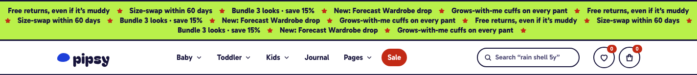
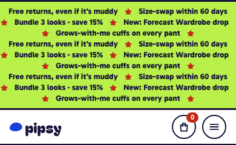
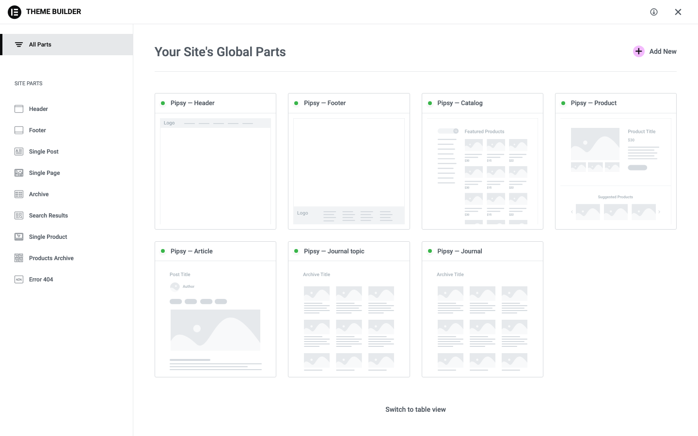

# Site Header

The Pipsy header is a **Kitify Theme Builder** template called **Pipsy — Header**. It is imported with the demo and shown on the entire site.

<figure><figcaption>
The header on desktop
</figcaption></figure>

It contains:

* A **tape marquee** (Kitify Text Marquee): a Lime strip with scrolling store messages.
* A white, sticky bar with the **logo** (Kitify Logo), the main **menu** with the [mega menu](../theme-options/menus-and-mega-menu.md) (Kitify Nova Menu), **search** (Kitify Search), **wishlist** (Kitify WCBoost Wishlist) and the **bag** (Kitify Nova Cart, opens the mini cart).
* On tablet and mobile, a menu button that opens the mobile drawer. Search is hidden on tablet and mobile and the wishlist button is hidden on mobile.

<figure><figcaption>
The header on mobile
</figcaption></figure>

## Edit the header

**Step 1** – Go to **Kitify > Theme Builder**. You'll see all the templates of the site.

<figure><figcaption>
Kitify > Theme Builder
</figcaption></figure>

**Step 2** – Click **Pipsy — Header** to open it in Elementor.

**Step 3** – Change the content and style. Background color, border, padding, gap and sticky behavior are Elementor settings of the header containers; most colors are linked to the Pipsy Global Colors.

**Step 4** – Click **Publish**. To change where the header appears, click the arrow next to Publish and choose **Display Conditions**.

## Common changes

* **Logo** – select the Logo widget and choose your image, or set the logo in **Theme Options > Header > Logo**. When the widget has no image, it shows the Site Title. See [Theme Options](../theme-options/theme-options.md#logo).
* **Tape messages** – select the Text Marquee widget and edit its items. The demo repeats five messages three times so the strip stays filled on wide screens; keep enough items for the same reason.
* **Menu** – the Menu widget shows the menu selected in its settings. Edit the menu items in **Appearance > Menus**.
* **Sticky bar** – select the container of the bar and open **Advanced > Motion Effects > Sticky**.
* **Wishlist and bag badges** – the counters update automatically.

## Header over the first section

On a page with a large hero at the top, the header can sit over the first section until the page scrolls.

1. Edit the page with Elementor and open **Page Settings** (the gear icon).
2. Open the **Pipsy header** section.
3. Set **Header over the first section** to:
   * **Off** – the default.
   * **Floating card** – the header floats over the first section as its own card.
   * **Transparent, light text** – the header is transparent with light text, for dark photos.

The tape marquee is hidden on a page that uses this setting.

For more about Kitify headers, see [Create Headers & Footers](https://docs.novaworks.net/kitify/theme-builder/create-headers-and-footers).
