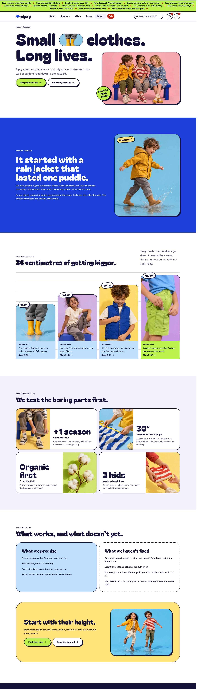
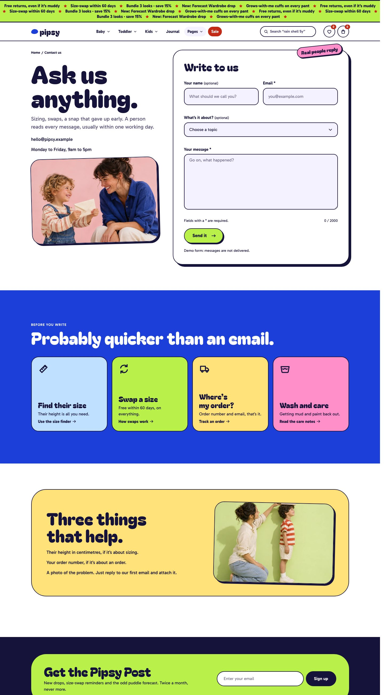
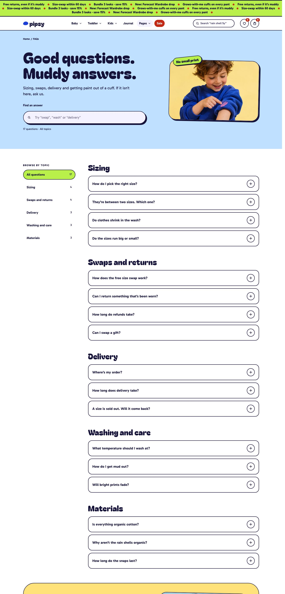

# About, Contact & FAQs

The demo comes with three content pages built with Elementor: **About us**, **Contact us** and **FAQs**. Edit each of them from **Pages > Edit with Elementor**. Their texts are demo copy: replace them with your own.

## About us

<figure><figcaption>
The About us page
</figcaption></figure>

The page is made of containers and Elementor core widgets (Heading, Text Editor, Image, Button) plus **Kitify Breadcrumbs**. It has a hero, a "how it started" story, and a **height wall**: four bars that rise from the floor, each linking to the shop filtered by a size.

To change the links of the height wall, select each bar and edit its link. The size filter uses the slug of your size terms, see [Sizes & Size Finder](../woocommerce/sizes-and-size-finder.md).

## Contact us

<figure><figcaption>
The Contact us page
</figcaption></figure>

The page has a hero with the contact form, a row of shortcut tiles that link to the most common answers, and a closing band.

The form is a **Contact Form 7** form called **Pipsy contact**, placed with a Shortcode widget. It has a name, an email, a topic select, a message and a submit button.

To make the form send mail:

1. Go to **Contact > Contact Forms** and open **Pipsy contact**.
2. Open the **Mail** tab and set **To** to your own address, and **From** to an address on your domain.
3. Save, then send a test message from the Contact page.


Until you set the **Mail** tab, messages are not delivered to you. Many hosts also need an SMTP plugin for reliable delivery.


To change the topics or the labels, edit the form template in the **Form** tab. Keep the CSS classes of the fields so the form keeps its design.

## FAQs

<figure><figcaption>
The FAQs page
</figcaption></figure>

The page has a search field in the hero, a list of topics in the sidebar, and one group of questions per topic.

* Each **group** is a container with the CSS class `fr-faq-group`, holding a Heading (the topic name) and a **Kitify Accordion** (the questions).
* The search field and the topic list are two copies of the [Pipsy FAQ Index](../elementor/more-pipsy-widgets.md#pipsy-faq-index) widget: one with **Part: Search**, one with **Part: Topics**. They find the groups by the class set in **Group class**, count their questions and filter them.

To add a topic:

1. Duplicate one of the group containers.
2. Change its heading and the items of its accordion.
3. Give the container a unique **CSS ID** (**Advanced > CSS ID**) if you want to link to it from another page, for example `/faqs/#faq-swaps`.

The new topic appears in the topic list automatically.
