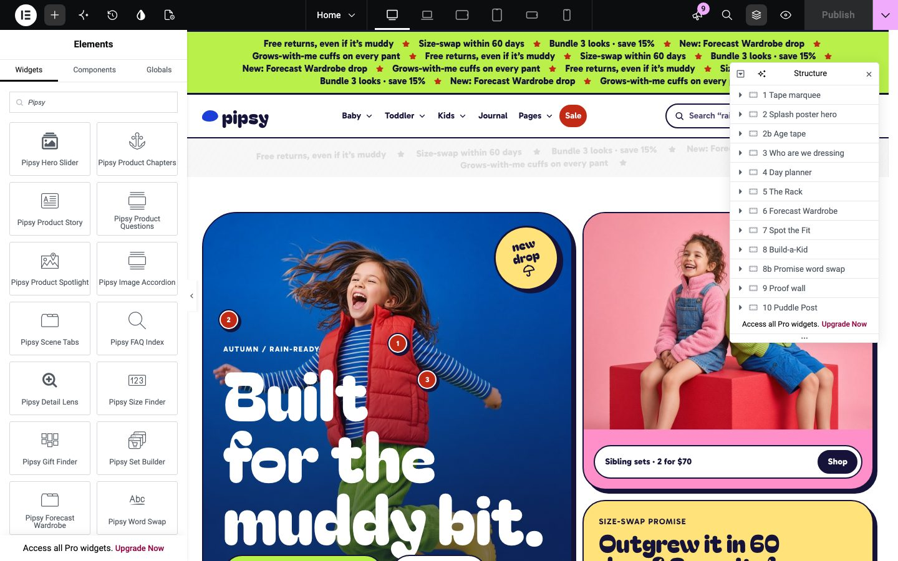
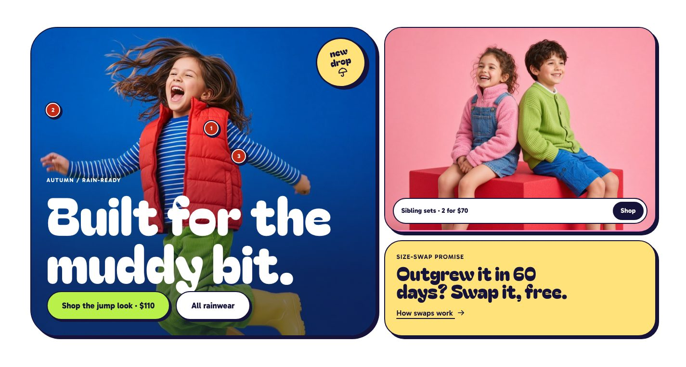
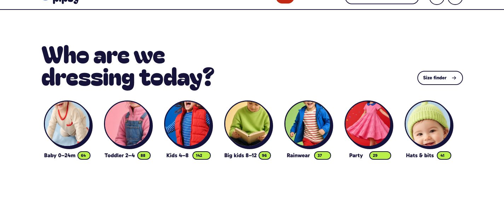
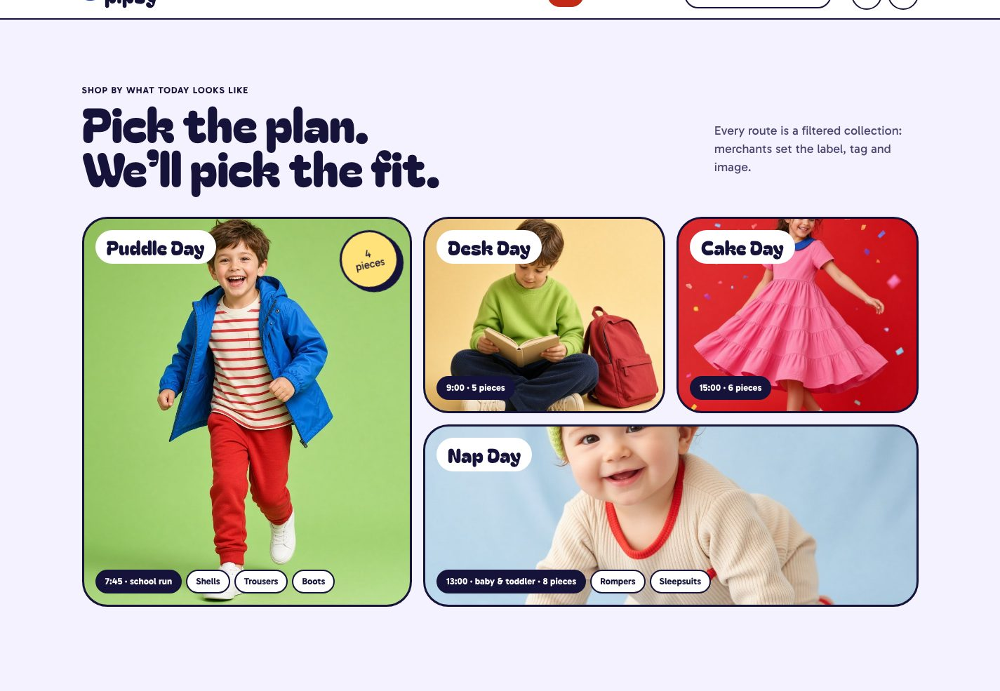
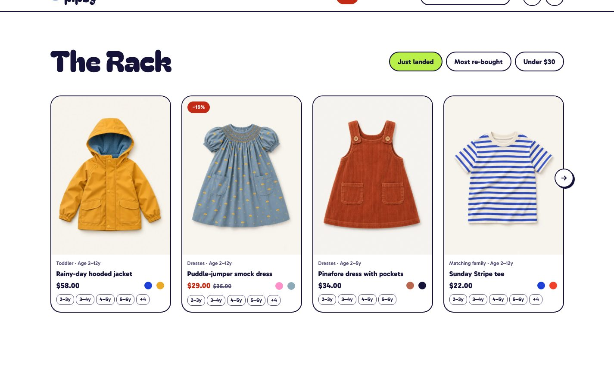
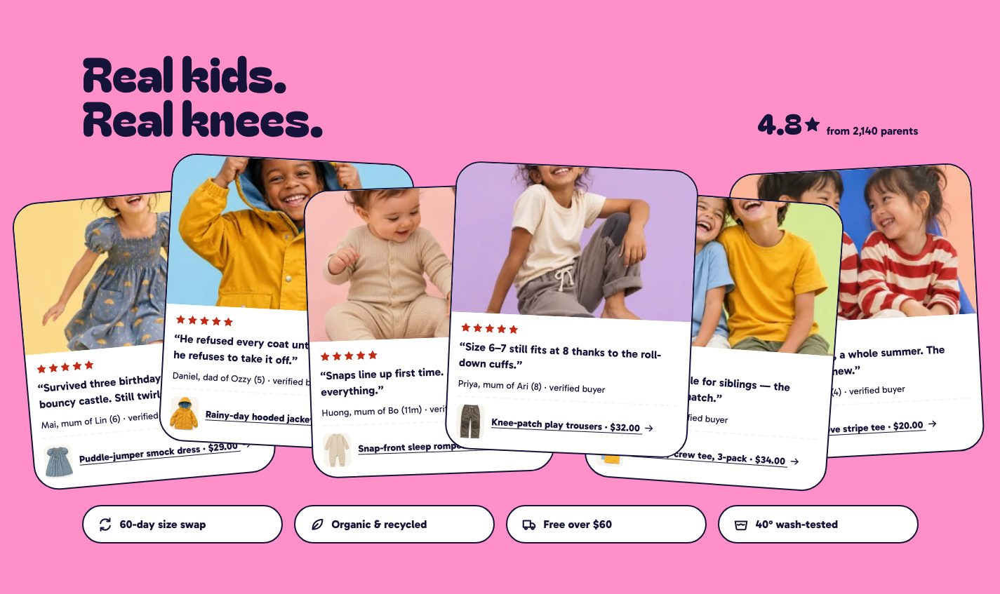
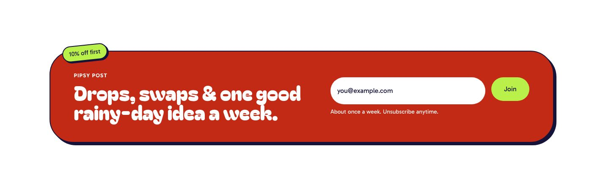
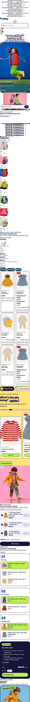

# Home Page

The demo home page is a regular page called **Home**, built with Elementor and set as the front page in **Settings > Reading**. To edit it, open **Pages**, hover **Home** and click **Edit with Elementor**.

<figure><figcaption>
The Home page in Elementor, with the Pipsy widgets in the panel and the sections in the Structure panel
</figcaption></figure>

Each section is an Elementor **container**. Its background, padding and width are set on the container (**Style** and **Advanced** tabs), and the content inside is made of Elementor, Kitify and Pipsy widgets. Open **Structure** in the editor to see the sections by name.

## Sections

| # | Section | Built with | What to edit |
| --- | --- | --- | --- |
| 1 | Tape marquee | Kitify Text Marquee | Hidden on the page: the tape is shown by the [header](../layout/site-header.md) instead. |
| 2 | Splash poster hero | Containers, Heading, Button, Image, Kitify Hotspots | Hero photo (container background), heading, buttons, the product pins and the two side tiles. |
| 2b | Age tape | Kitify Text Marquee | The repeated line and its separator. |
| 3 | Who are we dressing | Containers, Image, Heading | The round age chips: photo, label, count and link of each chip. |
| 4 | Day planner | Containers, Heading, Button | Photo cards (container backgrounds), their labels and links to filtered shop pages. |
| 5 | The Rack | Elementor Tabs, Kitify Woo Products | Tab names and the products of each tab. |
| 6 | Forecast Wardrobe | [Pipsy Forecast Wardrobe](../elementor/pipsy-forecast-wardrobe.md) | Forecasts, their colors, copy and products. |
| 7 | Spot the Fit | Kitify Hotspots, [Pipsy Set Builder](../elementor/pipsy-set-builder.md) (Family layout) | The photo, its hotspots and the products of the look. |
| 8 | Build-a-Kid | [Pipsy Set Builder](../elementor/pipsy-set-builder.md) (Steps layout) | Steps, products and the set discount. |
| 8b | Promise word swap | [Pipsy Word Swap](../elementor/pipsy-word-swap.md) | Photos, word pairs, lines and links. |
| 9 | Proof wall | Heading, Kitify Testimonials | Rating line and the review cards. |
| 10 | Puddle Post | Heading, Kitify Subscribe Form | Newsletter card. Needs MailChimp, see [Site Footer](../layout/site-footer.md). |

### Hero

<figure><figcaption>
Section 2 – Splash poster hero
</figcaption></figure>

The numbered pins on the photo are a **Kitify Hotspots** widget. Each pin is linked to a product and shows its name and lowest price. To change a pin, select the widget, open the hotspot item and choose another product or move its position.

The header floats over this section because the page uses **Page Settings > Pipsy header > Header over the first section**. See [Site Header](../layout/site-header.md#header-over-the-first-section).

### Age chips and Day planner

<figure><figcaption>
Section 3 – Who are we dressing today?
</figcaption></figure>

<figure><figcaption>
Section 4 – Day planner
</figcaption></figure>

Chips and cards link to the shop filtered by age, category or tag, for example `/shop/?filter_age=toddler` or a product tag page. Change the link of each container or button to match your own categories.

### The Rack

<figure><figcaption>
Section 5 – The Rack
</figcaption></figure>

Each tab holds a **Kitify Woo Products** widget. Select it to choose the products by category, tag or ID, and how many to show.

### Forecast Wardrobe, Spot the Fit, Build-a-Kid and Word Swap

These sections use Pipsy's own widgets. Each has its own page:

* [Pipsy Forecast Wardrobe](../elementor/pipsy-forecast-wardrobe.md)
* [Pipsy Set Builder](../elementor/pipsy-set-builder.md)
* [Pipsy Word Swap](../elementor/pipsy-word-swap.md)

### Proof wall and newsletter

<figure><figcaption>
Section 9 – Proof wall
</figcaption></figure>

<figure><figcaption>
Section 10 – Puddle Post
</figcaption></figure>


The reviews, ratings and counts of the demo are sample content. Replace them with real ones from your store before you go live.


## Mobile

Every section has its own tablet and mobile settings. Use the device switcher at the top of the Elementor editor to check and adjust each breakpoint.

<figure><figcaption>
The home page on a phone
</figcaption></figure>

## Tips

* Use the **Global Colors** (Paper, Surface, Sky, Bubble, Butter, Lime, Cobalt, Tomato and the others) for backgrounds and text, so the page follows your [Theme Options](../theme-options/colors-and-typography.md).
* Don't remove the CSS classes of the sections (**Advanced > CSS Classes**, for example `pipsy-home-rack`): the theme uses them for the outlines, stickers and other details of the design.
* To reuse a section on another page, right-click its container, choose **Save as Template**, then insert it from the template library.
