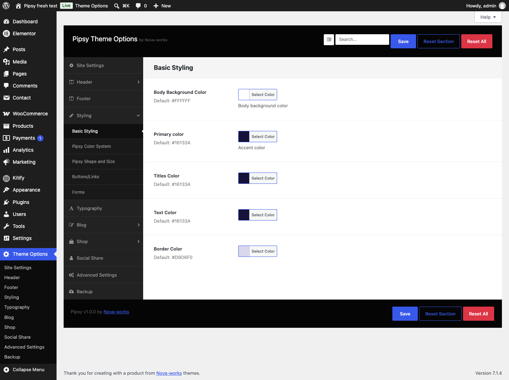
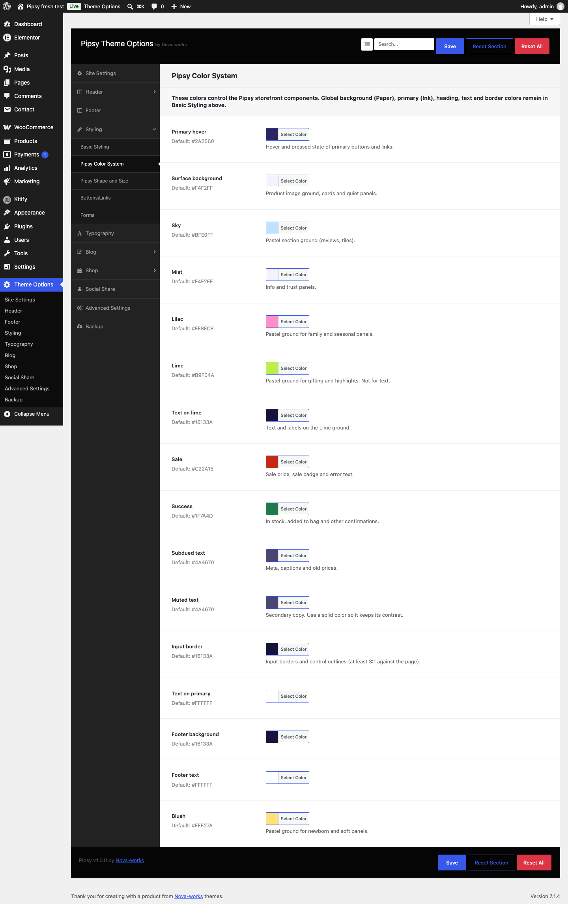
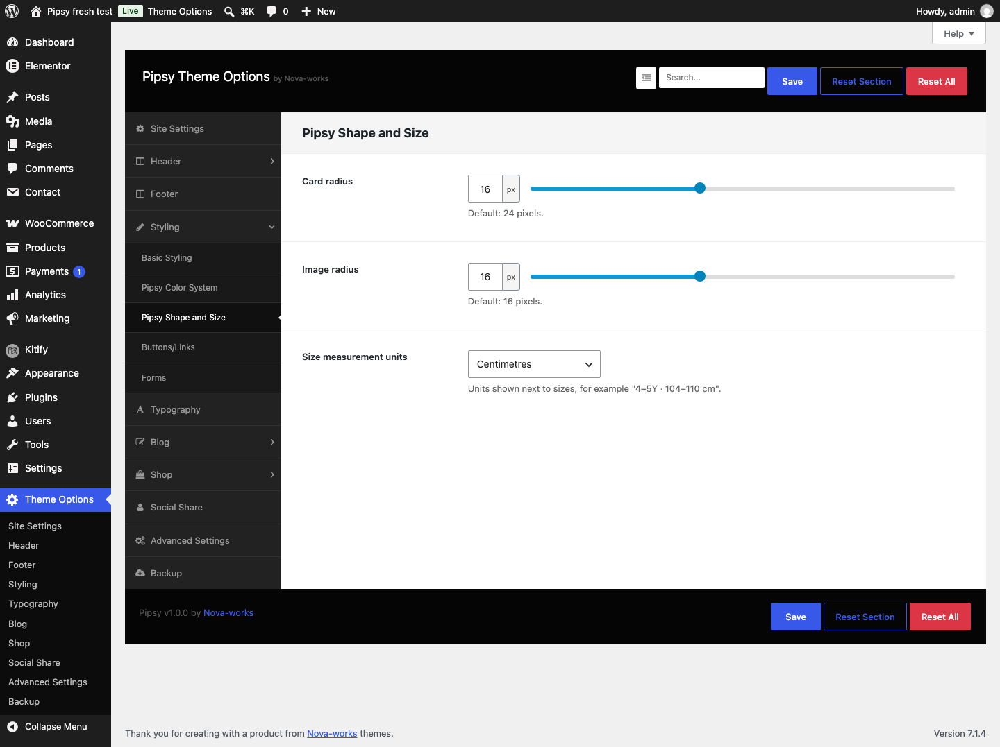
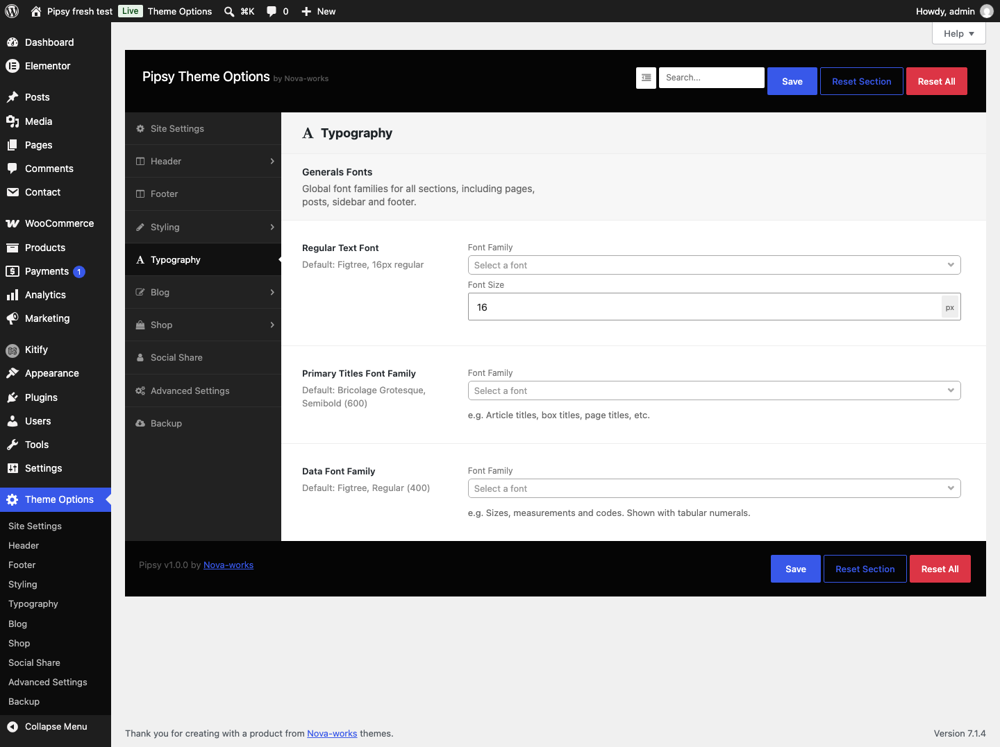

# Colors & Typography

Pipsy keeps its design tokens in one place: **Theme Options**. Every color and font you set there is used by the theme's own CSS and is also copied to the Elementor **Global Colors** and **Global Fonts**, so the color and font pickers in the Elementor editor offer the same palette.

## Basic Styling

Go to **Theme Options > Styling > Basic Styling**.

<figure><figcaption>
Theme Options > Styling > Basic Styling
</figcaption></figure>

| Option | Demo value | Used for |
| --- | --- | --- |
| Body Background Color | `#FFFFFF` | Page background ("Paper") |
| Primary color | `#16133A` | Brand color ("Ink"): buttons, outlines, active states |
| Titles Color | `#16133A` | Headings |
| Text Color | `#16133A` | Body text |
| Border Color | `#D9D6F0` | Lines, card and field borders |

## Pipsy Color System

Go to **Theme Options > Styling > Pipsy Color System**. These colors are the surfaces and accents used across the demo sections.

<figure><figcaption>
Theme Options > Styling > Pipsy Color System
</figcaption></figure>

| Option | Demo value | Used for |
| --- | --- | --- |
| Primary hover | `#2A2560` | Hover and pressed state of primary buttons and links |
| Surface background | `#F4F2FF` | Product image ground, cards and quiet panels |
| Sky | `#BFE0FF` | Pastel section ground (reviews, tiles) |
| Mist | `#F4F2FF` | Info and trust panels |
| Lilac | `#FF8FC8` | Pastel ground for family and seasonal panels (named "Bubble" in the Elementor Global Colors) |
| Lime | `#B9F04A` | Pastel ground for gifting and highlights. Not for text |
| Text on lime | `#16133A` | Text and labels on the Lime ground |
| Sale | `#C22A15` | Sale price, sale badge and error text |
| Success | `#1F7A4D` | In stock, added to bag and other confirmations |
| Subdued text | `#4A4670` | Meta, captions and old prices |
| Muted text | `#4A4670` | Secondary copy |
| Input border | `#16133A` | Input borders and control outlines |
| Text on primary | `#FFFFFF` | Text on Ink buttons |
| Footer background | `#16133A` | Footer band |
| Footer text | `#FFFFFF` | Footer text |
| Blush | `#FFE27A` | Pastel ground for newborn and soft panels (named "Butter" in the Elementor Global Colors) |

The Elementor Global Colors also include two accents used by the demo, **Cobalt** (`#1D3FD9`) and **Tomato** (`#F0412A`).

<!-- TODO: Cobalt and Tomato exist as Elementor Global Colors and in the theme palette, but have no field in Theme Options > Pipsy Color System. Confirm where merchants should change them (Elementor > Site Settings > Global Colors). -->

In Elementor, these colors appear in every color picker under **Global Colors**. When you set a section background or a text color to a global color, it follows any later change you make in Theme Options.


Keep enough contrast when you change the palette: body text needs at least 4.5:1 against its background, and input borders at least 3:1. Lime is a background color; text on it should stay dark.


## Pipsy Shape and Size

Go to **Theme Options > Styling > Pipsy Shape and Size**.

<figure><figcaption>
Theme Options > Styling > Pipsy Shape and Size
</figcaption></figure>

| Option | Demo value | Used for |
| --- | --- | --- |
| Card radius | 24 px | Corner radius of cards and panels |
| Image radius | 16 px | Corner radius of images |
| Size measurement units | cm | Units shown next to sizes, for example "4–5Y · 104–110 cm" |

## Buttons, Links and Forms

* **Buttons/Links**: General link color (demo `#16133A`, hover `#1D3FD9`), Primary Button (demo: `#16133A` background, `#FFFFFF` text), Secondary Button (`#FFFFFF` background, `#16133A` text) and **Button radius** (the demo uses `100` for pill buttons).
* **Forms**: Field radius (demo 12 px), input box background and text colors, label text color, and submit button background and text colors. These options affect the contact and comment forms.

## Typography

Go to **Theme Options > Typography**.

<figure><figcaption>
Theme Options > Typography
</figcaption></figure>

| Option | Demo font | Used for |
| --- | --- | --- |
| Regular Text Font | Gabarito, 16px, regular | Body text, navigation, buttons, product cards |
| Primary Titles Font Family | Bagel Fat One, 400 | Headings and display titles |
| Data Font Family | Gabarito, 400 | Sizes, measurements and codes, shown with tabular numerals |

Only the fonts you select here are loaded from Google Fonts. Adobe Fonts can be connected in **Kitify > Adobe Fonts**.


Bagel Fat One has a single weight (400). If you keep it for titles, don't set a bolder weight in Elementor: the browser would fake the bold.


## Site width

The content width is set in **Theme Options > Site Settings > Site Width** (demo: 1280 px). Elementor's own container width is set in **Elementor > Site Settings > Layout > Content Width** (demo: 1200 px); boxed sections of the demo pages follow it.
