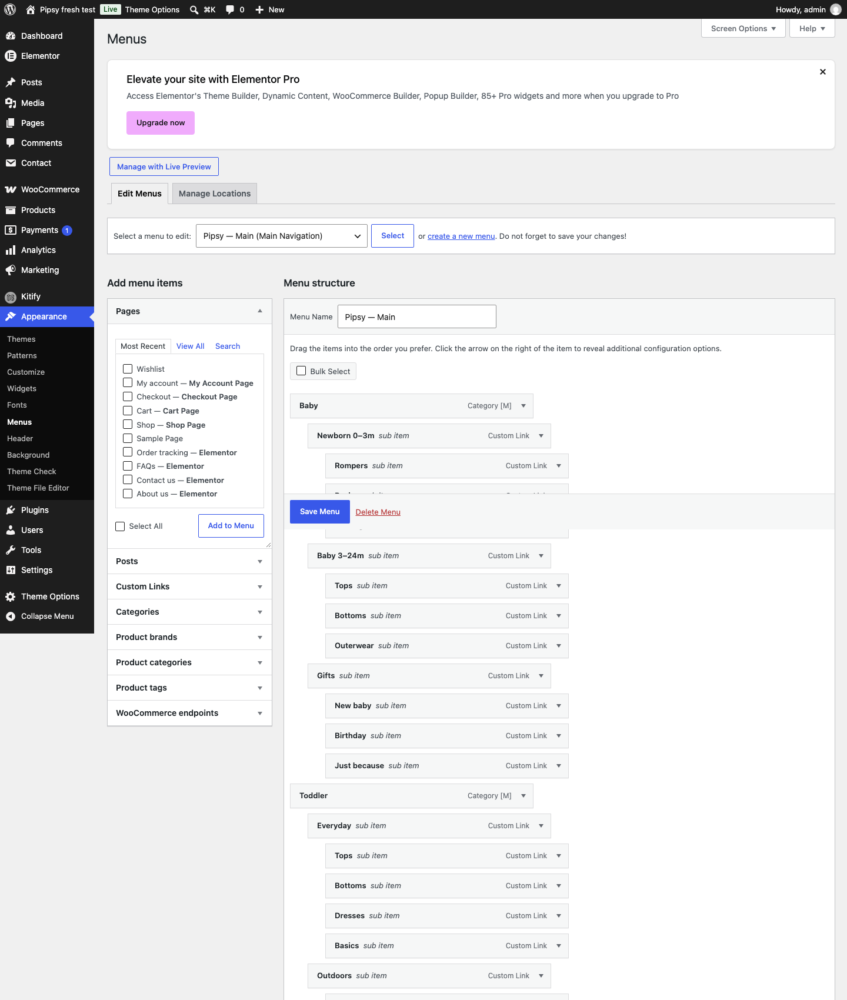
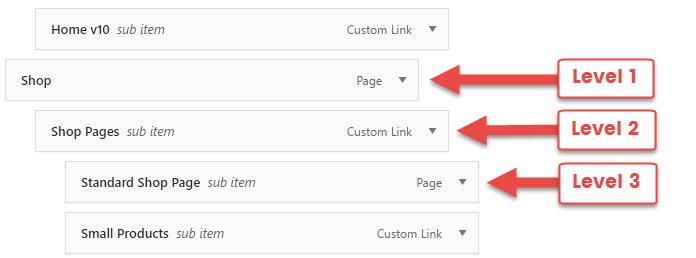
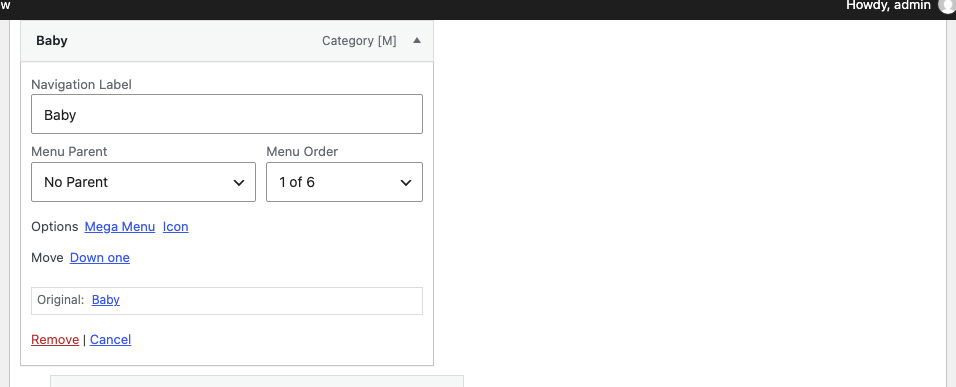
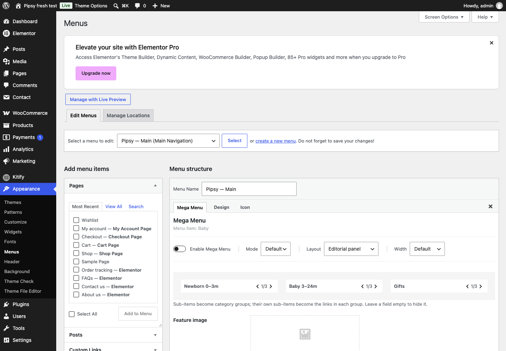
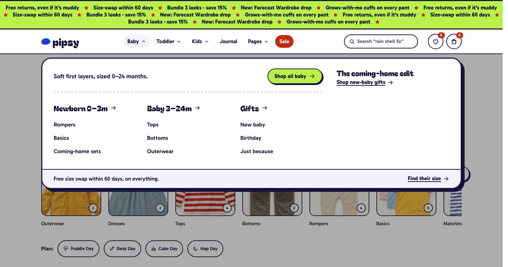

# Menus & Mega Menu

## Menu locations

Pipsy registers these menu locations. Assign your menus to them in **Appearance > Menus > Manage Locations**.

| Location | Demo menu | Where it shows |
| --- | --- | --- |
| Main Navigation | Pipsy — Main | The header menu and the mobile drawer |
| Footer: Shop | Pipsy — Footer Shop | First footer menu group |
| Footer: Help | Pipsy — Footer Help | Second footer menu group |
| Footer: Explore | Pipsy — Footer Follow | Third footer menu group (social links in the demo) |
| Top Bar (Mobile) | – | Classic PHP header only |
| Fullscreen Menu | – | Classic PHP header only |

<figure> Menus with the Pipsy main menu"><figcaption>
Appearance > Menus
</figcaption></figure>

The demo main menu has three age groups with a mega menu (**Baby**, **Toddler**, **Kids**), a **Journal** link, a regular dropdown with the help pages, and a **Sale** link.


To show a menu item as the red pill used by **Sale**, open **Screen Options** at the top of the Menus page, tick **CSS Classes**, then add `menu-item--hot` to the item's **CSS Classes** field.


## Mega Menu

**Pipsy** comes with a built-in mega menu, added by the **Pipsy Core** plugin. You don't need to buy or install an extra plugin. Mega menus are set up in **Appearance > Menus**; they can't be set up in the Customizer.

A mega menu can be enabled on any first level menu item. This image shows the menu item levels:

<figure><figcaption></figcaption></figure>

### Enable Mega Menu

**Step 1** – Go to **Appearance > Menus** and select your main menu.

**Step 2** – Open a top level (level 1) menu item with the arrow on its right. Under its fields you'll find two links: **Mega Menu** and **Icon**.

<figure><figcaption>
The Mega Menu and Icon links of a menu item
</figcaption></figure>

**Step 3** – Click **Mega Menu**. A panel opens with three tabs: **Mega Menu**, **Design** and **Icon**.

<figure><figcaption>
Mega Menu settings of the Baby item
</figcaption></figure>

**Step 4** – Turn on **Enable Mega Menu**, then choose:

* **Mode** – _Default_ (columns from the sub-items), _Grid_ (rows and columns you build yourself) or _Tabs_ (each sub-item is a tab; **Tabs behavior** opens them on hover or on click).
* **Layout** (Default mode) – _Standard columns_ or _Editorial panel_.
* **Width** – _Default_, _Full width_ or _Custom_ with your own width.

**Step 5** – Click **Save Changes** in the panel, then **Save Menu**.

### Editorial panel

The demo uses the **Editorial panel** layout for Baby, Toddler and Kids: a wide panel with an intro line, groups of links, a feature card and a footer line.

<figure><figcaption>
The editorial panel of the Baby menu item
</figcaption></figure>

With **Editorial panel** selected, the panel shows these fields. Leave a field empty to hide that part.

| Field | What it shows | Demo (Baby) |
| --- | --- | --- |
| Feature image | The image of the feature card on the side | A product photo |
| Intro text | A short text at the top of the panel | "Soft first layers, sized 0–24 months." |
| "View all" label / URL | The button next to the intro | "Shop all baby" |
| Feature caption | Heading of the feature card | "The coming-home edit" |
| Feature link label / URL | Link of the feature card | "Shop new-baby gifts" |
| Footer text | A line at the bottom of the panel | "Free size swap within 60 days, on everything." |
| Footer link label / URL | Link at the end of the footer line | "Find their size" |

How the menu items are used:

* **Level 2** items are the group headings (in the demo: Newborn 0–3m, Baby 3–24m, Gifts).
* **Level 3** items are the links inside each group.

The panel opens on hover and on keyboard focus. Pressing **Escape** closes it and returns focus to the menu link.

### Standard columns, Grid and Tabs

* **Standard columns** – each level 2 item is a column, level 3 items are the links inside it. Change each column's width with the arrow buttons next to its name.
* **Grid** – click **Add a row**, add columns to the row, then **Add items to this column**. Besides menu items, a column can hold these blocks: **Heading**, **Image**, **Image Box**, **Banner**, **Button**, **Custom HTML**, **Taxonomy List** and **Taxonomy Grid** (product categories or brands).
* **Tabs** – each level 2 item becomes a tab; click **Edit Tab** to build its content as a grid.

For level 2 items and below, the settings panel offers:

* **Settings** – **Visibility** (Visible, Hidden, or Empty to keep the spacing) and **Disable link**.
* **Design** – padding, margin and a background image or color for the column.
* **Content** – custom HTML or a shortcode shown with the item.

### Menu item icon

The **Icon** tab adds an icon to any menu item: choose a theme icon, upload an image or paste SVG code, set its color and background color, and optionally **Hide Text**.


On tablet and mobile (1024 px and below) the menu is shown in the mobile drawer. Mega menu items open as a list there.

