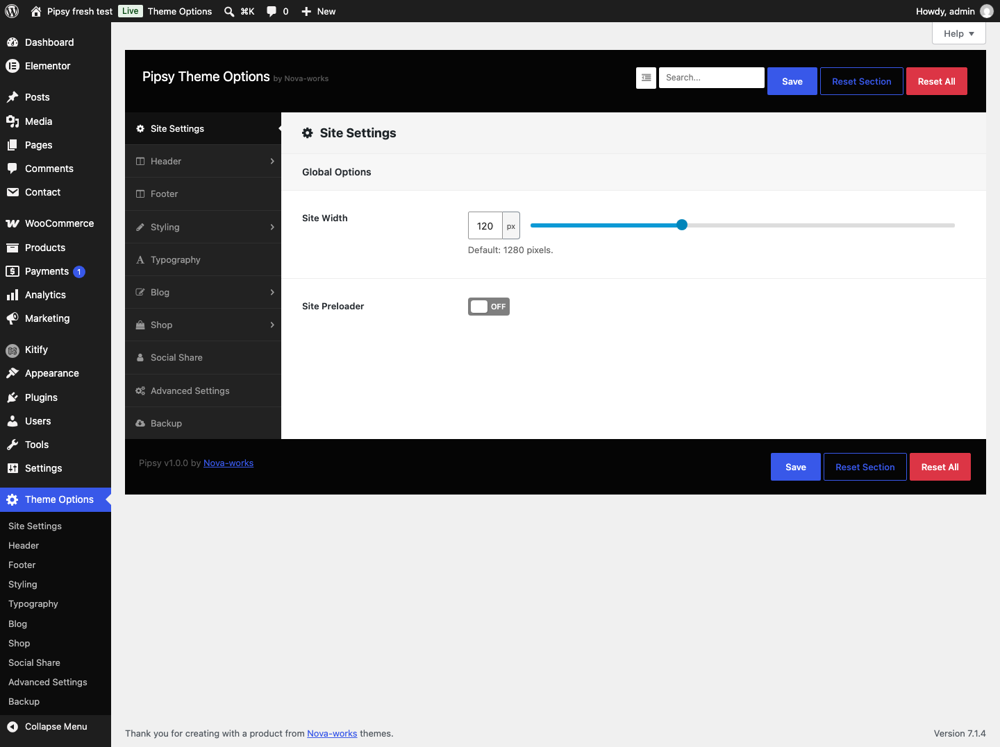
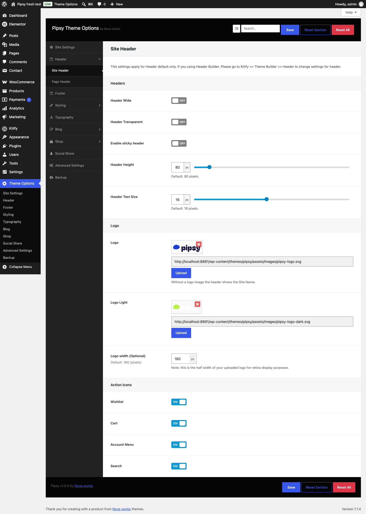
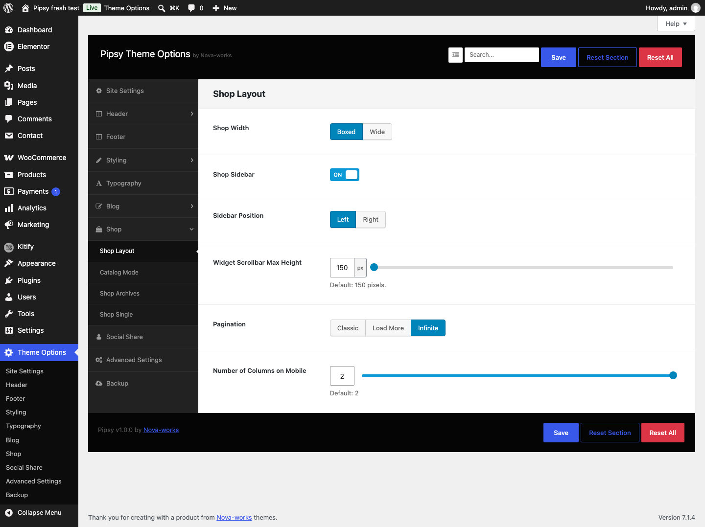

# Theme Options

Theme Options let you change the look and behavior of your site without touching a single line of code. They are added by the **Pipsy Core** plugin.

You can open them from **Admin Dashboard > Theme Options**.

<figure><figcaption>
Theme Options > Site Settings
</figcaption></figure>

The options are grouped into sections. Below is what each section controls.

| Section | What you can change |
| --- | --- |
| **Site Settings** | **Site Width** (the demo uses 1280 px), **Site Preloader** and the **Top Loading Progress Bar**. |
| **Header > Site Header** | Header Wide, Header Transparent, sticky header, Header Height (80 px), Header Text Size (16 px), **Logo**, **Logo Light**, Logo width (180 px) and the action icons (Wishlist, Cart, Account Menu, Search). |
| **Header > Page Header** | Page Header Type, background image, background, overlay, font and heading colors, height (300 px), font size (60 px) and the **Site Breadcrumb** switch. |
| **Footer** | Footer copyright text (HTML and shortcodes are allowed). The footer layout itself is a Kitify template, see [Site Footer](../layout/site-footer.md). |
| **Styling** | Basic Styling, the Pipsy Color System, Pipsy Shape and Size, Buttons/Links and Forms. See [Colors & Typography](colors-and-typography.md). |
| **Typography** | Regular text font, primary titles font and data font. See [Colors & Typography](colors-and-typography.md). |
| **Blog** | Blog Archives: wide layout, excerpt, read more button, sidebar and its position, pagination (Classic, Load More button, Infinite). Blog Single: sidebar, featured image, social share, author box and post navigation. |
| **Shop** | Shop Layout, Catalog Mode, Shop Archives and Shop Single. See the table below. |
| **Social Share** | Which networks appear in the share buttons: Facebook, Twitter, Reddit, LinkedIn, Tumblr, Pinterest, Line, VK, WhatsApp, Telegram, Email. |
| **Advanced Settings** | Open Graph meta tags, custom CSS, and custom scripts below `<head>`, after the opening `<body>` and before the closing `</body>`. |
| **Backup** | Export your Theme Options to a file or import them from another site. |


**NOTE** - Click the **Save** button to store your changes. **Reset Section** restores the defaults of the section you are on; **Reset All** restores every option.



The **Site Header**, **Page Header**, **Blog** and most **Shop** layout options apply to the theme's classic PHP templates. The demo uses Kitify templates for the header, footer, shop, product and Journal pages; their layout is edited in Elementor (see [Site Header](../layout/site-header.md), [Shop Page Layout](../woocommerce/shop-page-layout.md), [Product Page Layout](../woocommerce/product-page-layout.md) and [Journal](../journal/journal.md)). The options always apply to pages where no Kitify template is active.


## Logo

Go to **Theme Options > Header > Site Header > Logo**.

<figure><figcaption>
Theme Options > Header > Site Header
</figcaption></figure>

* **Logo** – the logo on light backgrounds. The Kitify Logo widgets in the demo header and footer use this image when they have no image of their own.
* **Logo Light** – the logo for dark backgrounds, such as a transparent header over a photo.
* **Logo width** – the displayed width in pixels (default 180). For a sharp logo on retina screens, upload an image twice this width, or use an SVG.

Without a logo image, the header shows the **Site Title** from **Settings > General**. The browser tab icon is set in **Appearance > Customize > Site Identity > Site Icon**.

## Shop options

<figure><figcaption>
Theme Options > Shop > Shop Layout
</figcaption></figure>

| Group | Options (default) |
| --- | --- |
| **Shop Layout** | Shop Width (Boxed), Shop Sidebar (on) and Sidebar Position (Left), Shop Filters (on), Widget Scrollbar Max Height (150 px), Pagination (Infinite), Number of Columns on Mobile (2). |
| **Catalog Mode** | Catalog Mode (off) hides the buying buttons so the store works as a catalog; Remove Product Price (off). |
| **Shop Archives** | Number of Columns (3), products per page choices (`12,15,30`) and default (12), Show add to cart button, Show Wishlist button, Show Quickview button, Product Image on Hover, Show Grid List Switch, Sale badge (discount percentage, wording "Sale!"), New badge (wording "New!", by last added days or last _x_ products). |
| **Shop Single** | Single Product Sidebar and position, Display Social Share, Up-sells Display, Related Products Display and number (4), Image Zoom, Image Lightbox. |
