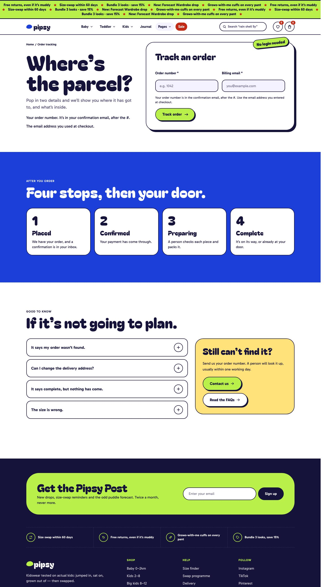

# Order Tracking

The **Order tracking** page lets a customer check an order with the order ID and the billing email, without logging in.

<figure><figcaption>
The Order tracking page
</figcaption></figure>

## How it works

The page is built with Elementor. The form is WooCommerce's own shortcode `[woocommerce_order_tracking]`, placed in a card with a Shortcode widget. Pipsy styles the form and the result:

1. The customer enters the **Order ID** and the **Billing email**, both found in the order confirmation email.
2. The page shows the order status, the items and the order updates.

Under the form the page has an "After you order" band with the steps of an order, and a "Good to know" band with a Kitify Accordion.

## Edit the page

Open **Pages > Order tracking > Edit with Elementor**. The headings, the steps and the accordion are regular widgets; their texts are demo copy for you to replace.

## Add the page to a menu

The demo links the page from the **Pages** dropdown of the main menu. Add or move it in **Appearance > Menus**.


The order updates shown to the customer are the **customer notes** you add to an order in **WooCommerce > Orders** (choose _Note to customer_ when adding a note). Private notes are not shown.

