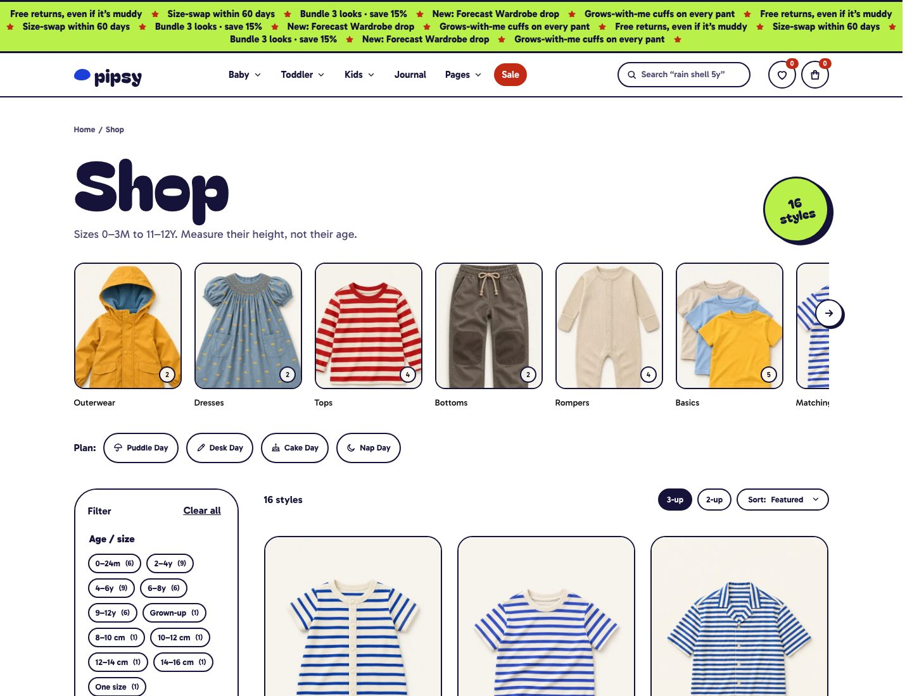

# Product Filter

The filters on the shop page are the **Novaworks - Products Filter** widget, added by the **Pipsy Core** plugin. In the demo it sits inside the **Pipsy — Catalog** template; it is also available as a classic widget in **Appearance > Widgets** for the shop sidebar.

<figure><figcaption>
The filter panel on the shop page
</figcaption></figure>

## Demo filters

| Filter | Source | Display |
| --- | --- | --- |
| Age / size | Attribute _Size_ | Checkbox chips, multiple select. Sizes that share a **Filter group** are merged into one chip, for example "2–4y". |
| Colour | Attribute _Color_ | Swatches, multiple select |
| Category | Product categories | Checkbox list, empty categories hidden |
| Price | Price | Ranges: 0–25, 25–40, 40 and up |
| Extras | Product status | On sale |
| (no title) | Attribute _Feature_ | Checkbox list. Shown only when products use this attribute. |

## Edit the filters

1. Go to **Kitify > Theme Builder** and open **Pipsy — Catalog**.
2. Select the **Product filters** widget.
3. Each filter is one row. For every row you can set:

| Setting | Options |
| --- | --- |
| **Filter Name** | The title above the filter |
| **Filter By** | Search, Categories, Attribute, Price, Rating, Product Status, or a product group (Best Sellers, New Products, Sale Products, Hot Products) |
| **Attribute** | The attribute to filter by, when **Filter By** is Attribute |
| **Display Type** | Auto, Checkbox List, Dropdown, Horizontal List, Vertical List, Slider or Ranges (price) |
| **Selection Type** | Single select or Multiple select |
| **Query Type** | AND / OR, for multiple select |
| **Ranges** | Price ranges, one per line, separated by `-`. Do not include the currency symbol |
| **Show product counts**, **Show the search box**, **Hide empty categories**, **Show See More** | Display helpers |

General settings of the widget:

* **Use ajax for filtering** – update the products without reloading the page.
* **Filtering products instantly (no buttons required)** – apply each choice at once.
* **Update URL** – keep the selected filters in the page address, so a filtered view can be shared.

The demo keeps these three settings off: the page reloads with the chosen filters in the address.

## Size filter groups

With many sizes, a chip per size would make a long list. Pipsy lets several sizes share one chip:

1. Go to **Products > Attributes > Size > Configure terms** and edit a size.
2. Fill **Filter group**, for example `2–4y`.
3. Give the same label to every size of that stage.

Sizes with the same label share one chip in the catalog filter. See [Sizes & Size Finder](sizes-and-size-finder.md).
