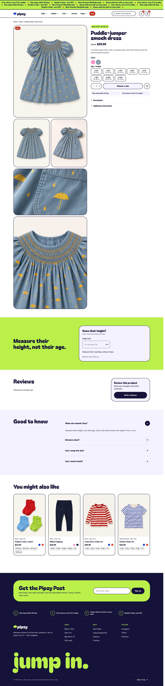
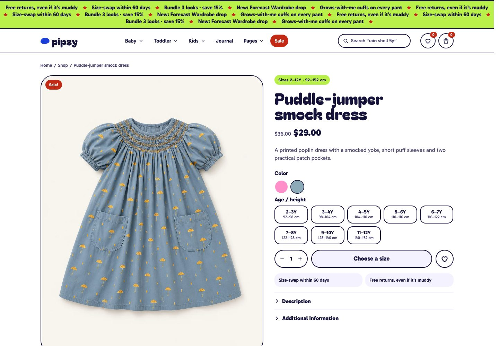
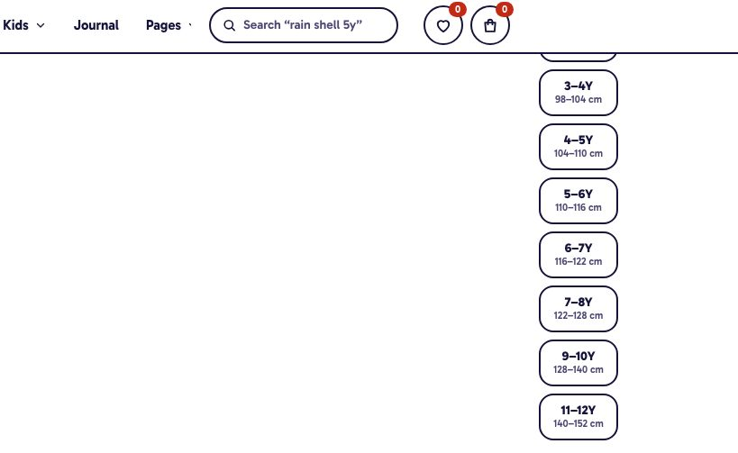

# Product Page Layout

Every product of the demo uses one **Kitify Theme Builder** template called **Pipsy — Product** (type _Single Product_). The widgets read the data of the current product, so one template serves the whole catalog.

<figure><figcaption>
The product page
</figcaption></figure>

## Sections of the template

| Section | Widgets | Shown when |
| --- | --- | --- |
| Breadcrumb | Kitify Breadcrumbs | Always |
| Photo mosaic | Kitify Product Images | Always. Uses the product image and gallery |
| Summary (sticky beside the photos) | Shortcode `[pipsy_size_summary]`, Kitify Product Title, Rating, Price, Short Description, Add To Cart, Icon List (store promises), Product Data Tabs | Always |
| Size help | Heading, [Pipsy Size Finder](sizes-and-size-finder.md#size-finder) | Sizes have height ranges |
| Story | [Pipsy Product Story](product-story.md) | The product has a story in **Product data > Editorial** |
| Complete the look | Kitify Woo Products (up-sells) | The product has up-sells in **Product data > Linked Products** |
| Reviews | Heading, Kitify Post Comment | Always. WooCommerce reviews and the review form |
| Good to know | Heading, Pipsy Product Questions | Always. The questions are written in the widget |
| You might also like | Kitify Woo Products (related) | Related products exist |
| Recently viewed | Kitify Woo Products | The shopper has viewed another product |
| Sticky buy bar | Pipsy Product Chapters | Appears once the Add to cart form has scrolled out of view |

Sections with no data stay hidden, so a product without a story or up-sells doesn't show an empty band.

<figure><figcaption>
Photo mosaic and summary
</figcaption></figure>

## Edit the product template

**Step 1** – Go to **Kitify > Theme Builder**.

**Step 2** – Click **Pipsy — Product** to open it in Elementor. The editor previews the template with one of your products.

**Step 3** – Make your changes and click **Publish**. To use a different template for some products or categories, create another _Single Product_ template and set its **Display Conditions**.

## Common changes

* **Store promises under the button** ("Size-swap within 60 days", "Free returns, even if it's muddy") – select the Icon List widget and edit its items.
* **Good to know questions** – select the Pipsy Product Questions widget and edit the **Questions** repeater. See [Product page widgets](../elementor/more-pipsy-widgets.md#product-page-widgets).

<figure><figcaption>
The Good to know band
</figcaption></figure>

* **Section headings** – each band has a Heading widget ("Reviews", "Good to know", "You might also like").
* **Number of related products** – select the Woo Products widget of the band and change its count and columns.
* **Buy bar** – select the Pipsy Product Chapters widget. **Show selection bar** turns the bar on or off; **Edit link label** and **Label before a choice is made** set its texts.

## Product data that feeds the page

| On the page | Where to edit |
| --- | --- |
| Photos | **Product image** and **Product gallery** |
| Size buttons with heights | **Attributes > Size** and its variations. See [Sizes & Size Finder](sizes-and-size-finder.md) |
| Color swatches | **Attributes > Color**, **Swatches** tab |
| Intro under the price | **Product short description** |
| Description and Additional information toggles | The main product description, and the product attributes |
| Story | **Product data > Editorial**. See [Product Story](product-story.md) |
| Complete the look | **Product data > Linked Products > Upsells** |

## Shortcodes

Pipsy Core registers a few shortcodes for product and shop templates. Add them with Elementor's **Shortcode** widget.

| Shortcode | Output |
| --- | --- |
| `[pipsy_size_summary]` | The product's size and height range as a pill, for example "Sizes 2–12Y · 92–152 cm". Empty when the product has no sizes. |
| `[pipsy_product_details title="Product details & care" open=""]` | The product description inside a toggle. Set `open="1"` to show it open. Empty when the product has no description. |
| `[pipsy_catalog_count]` | The number of products in the current shop view, as a sticker. |
| `[pipsy_share label="Share"]` | Share links for the current post or product. |

## Quick view and wishlist

* **Quick view** opens the buy box of a product in a panel from the shop grid. Turn it on or off in **Theme Options > Shop > Shop Archives > Show Quickview button**.
* The **wishlist** heart next to Add to cart comes from WCBoost – Wishlist. See [Wishlist](wishlist.md).
