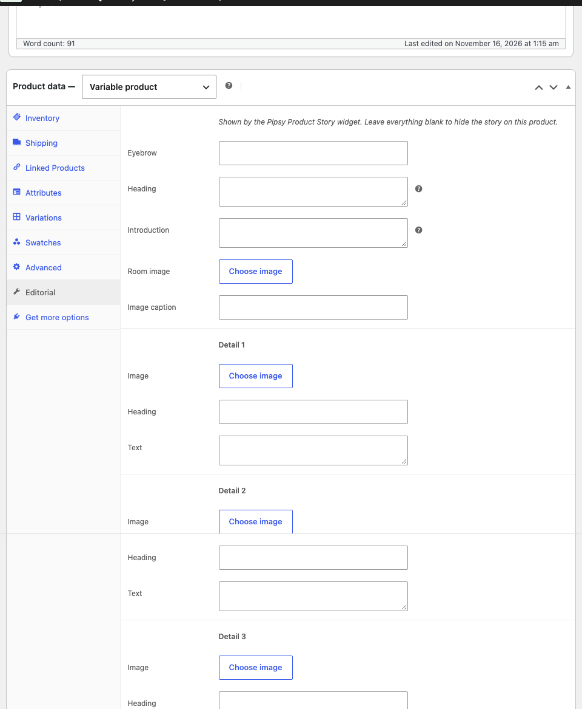

# Product Story

A product can have its own **story**: a short editorial block with a heading, an introduction, a large image and up to three close-up details. You write it once on the product; the **Pipsy Product Story** widget of the product template shows it.

## Add a story to a product

**Step 1** – Go to **Products**, edit a product and scroll to **Product data**.

**Step 2** – Open the **Editorial** tab.

<figure><figcaption>
Product data > Editorial
</figcaption></figure>

**Step 3** – Fill the fields:

| Field | Notes |
| --- | --- |
| **Eyebrow** | A short label above the heading |
| **Heading** | Line breaks are kept |
| **Introduction** | Basic HTML is allowed |
| **Room image** | The large image of the story. For kids fashion, use a lifestyle photo of the garment being worn |
| **Image caption** | Shown under the large image |
| **Detail 1–3** | Each detail has an **Image**, a **Heading** and a **Text**: fabric close-ups, cuffs, fastenings |

**Step 4** – Click **Update**.

Leave everything blank to hide the story on a product. The demo products have no story, so the band is hidden on the demo product pages.

## Style the story

Open the **Pipsy — Product** template in **Kitify > Theme Builder** and select the **Pipsy Product Story** widget.

### Content

| Control | What it does |
| --- | --- |
| **Heading tag** | H2 or H3 |
| **Show image caption** | Show or hide the caption of the large image |
| **Stagger details** | Offsets the detail cards vertically for a looser layout |

### Style

| Section | Controls |
| --- | --- |
| **Header** | Layout, gap, bottom spacing, and typography and color of the eyebrow, heading and introduction |
| **Room image** | Aspect ratio, border radius, bottom spacing; caption typography, color and top spacing |
| **Details** | Columns, gap, stagger offset, image aspect ratio, image border radius, image bottom spacing, and typography and colors of the detail heading and text |

<!-- TODO: add a frontend screenshot of the story band once a demo product has Editorial content. -->
