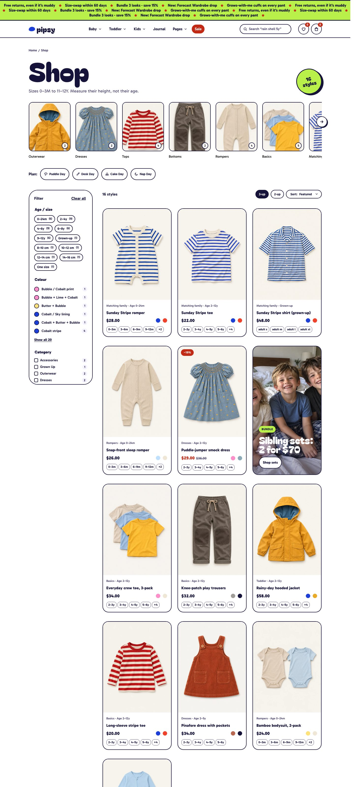
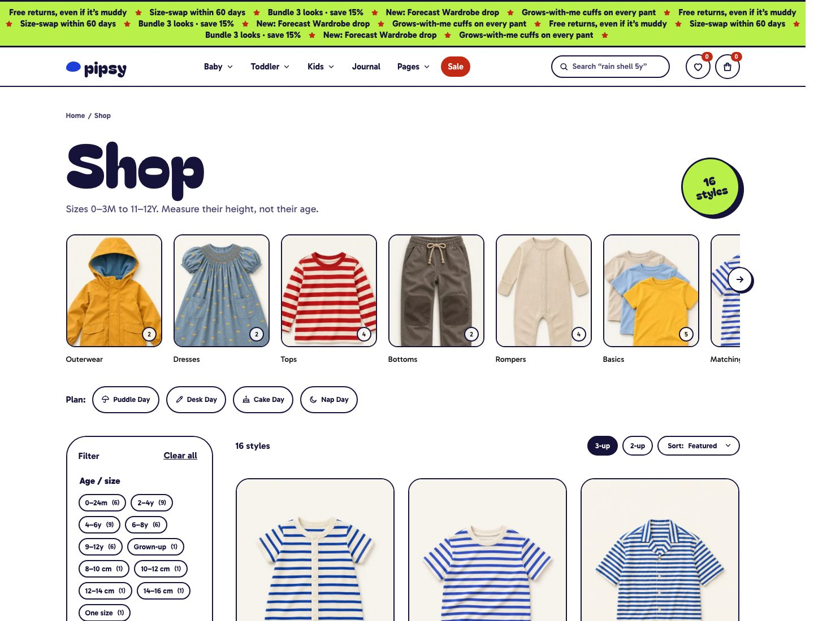

# Shop Page Layout

The shop page, product category pages and product tag pages of the demo use a **Kitify Theme Builder** template called **Pipsy — Catalog** (type _Products Archive_).

<figure><figcaption>
The shop page
</figcaption></figure>

From top to bottom, the template contains:

| Part | Widget | Notes |
| --- | --- | --- |
| Breadcrumb | Kitify Breadcrumbs | |
| Title and intro | Kitify Archive Title, Kitify Archive Description | On the main shop page they show the title and content of the **Shop** page; on a category they show the category name and description. |
| Count sticker | Shortcode `[pipsy_catalog_count]` | The round "16 styles" sticker: the number of products in the current view. |
| Category rail | Kitify Woo Categories | The categories and their order are chosen in the widget. |
| Plan chips | Heading and Buttons | Shortcuts to filtered shop pages (the same routes as the home Day planner). |
| Filters | Novaworks - Products Filter | See [Product Filter](product-filter.md). On tablet and mobile the filters open as a panel. |
| Product grid | Kitify Woo Products | 3 columns on desktop (2 on phones), with the result count, the 3-up / 2-up switch, sorting and pagination. |
| Promo tile | Template **Pipsy — Catalog promo** | An editorial tile placed inside the grid. |

## Edit the shop template

**Step 1** – Go to **Kitify > Theme Builder**.

**Step 2** – Click **Pipsy — Catalog** to open it in Elementor.

**Step 3** – Make your changes and click **Publish**. To change where the template is used, click the arrow next to Publish and choose **Display Conditions**.

## Common changes

* **Shop title and intro** – edit the **Shop** page title and content in **Pages**; category intros come from **Products > Categories > Description**.
* **Category rail** – select the Woo Categories widget, then include or exclude categories and set their order. Each category shows its thumbnail (**Products > Categories > Thumbnail**).
* **Columns and products per page** – select the Woo Products widget and change **Columns** per device and the number of products.
* **Promo tile** – select the Woo Products widget. At the end of its content section you'll find two Pipsy controls:
  * **Catalog editorial template ID** – the ID of a published Elementor template inserted in the grid. The demo uses **Pipsy — Catalog promo**; edit that template in **Templates** to change the photo, text and link. Set the field to `0` to remove the tile.
  * **Insert after product** – the position of the tile in the grid (the demo uses 5).

## Product card

<figure><figcaption>
Filters and product cards
</figcaption></figure>

Each product card shows the image, the category and age line, the name, the price, color swatches and the available sizes. Sold-out sizes are marked. Shoppers can switch color on the card; the image and price follow the selected variation.

* **Color swatches** come from the _Color_ attribute and the WCBoost – Variation Swatches plugin. Set each color in **Products > Attributes > Color**.
* **Sizes** come from the _Size_ attribute. See [Sizes & Size Finder](sizes-and-size-finder.md).
* **Badges** – the sale badge (percentage or "Sale!") and the "New!" badge are set in **Theme Options > Shop > Shop Archives**.
* **Buttons** – the wishlist and quick view buttons can be turned off in **Theme Options > Shop > Shop Archives**.

## Shop without the Kitify template

If you remove the **Pipsy — Catalog** template, the shop falls back to the theme's classic layout. Then the options in **Theme Options > Shop** (sidebar, columns, pagination, grid/list switch) and the widgets in **Appearance > Widgets > Shop** apply.
