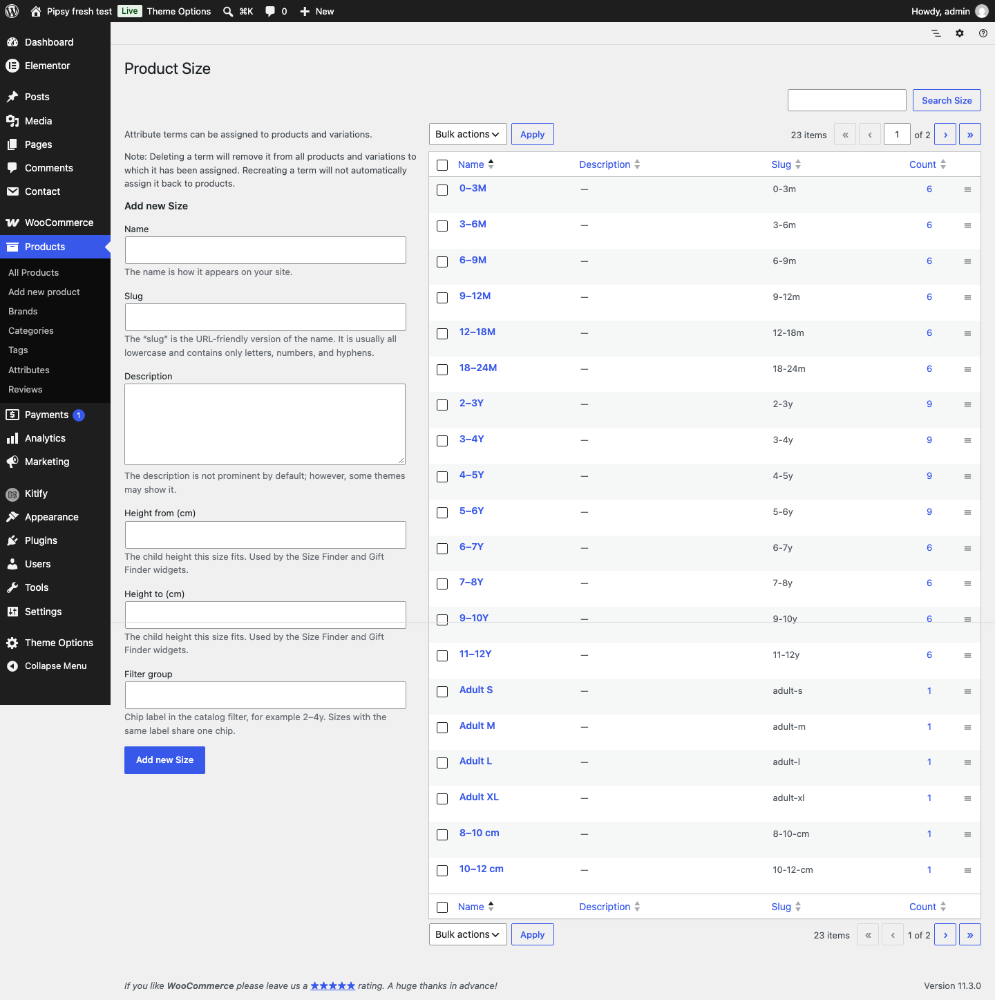
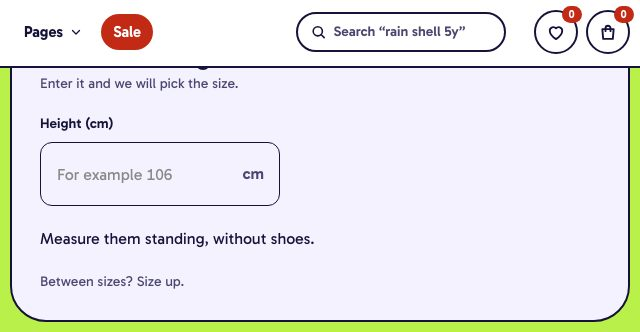
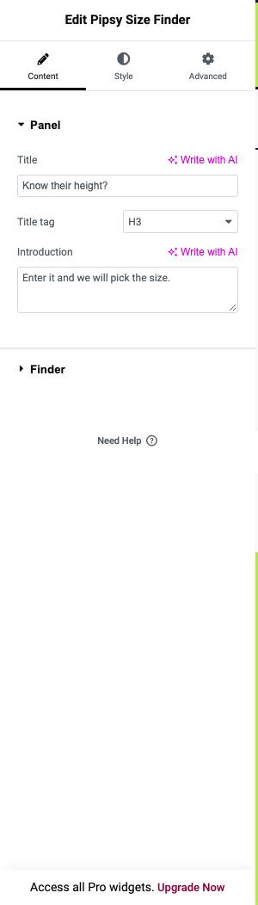
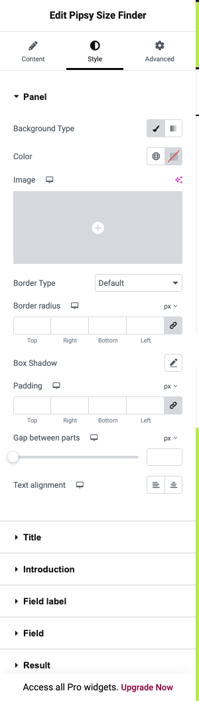

# Sizes & Size Finder

Kids grow fast, and an age label alone often gives the wrong size. In Pipsy every size can carry the **child height** it fits. The theme uses these heights on the product page, in the shop filter and in the **Size Finder**.

## Set up your sizes

**Step 1** – Go to **Products > Attributes**. Create an attribute called **Size** (slug `size`) if you don't have one. The demo import creates it for you.

**Step 2** – Click **Configure terms** and add your sizes, or edit the demo ones.

<figure> Attributes > Size"><figcaption>
Products > Attributes > Size
</figcaption></figure>

**Step 3** – For each size, fill the Pipsy fields:

| Field | What it does | Example |
| --- | --- | --- |
| **Height from (cm)** | The lowest child height this size fits | `98` |
| **Height to (cm)** | The highest child height this size fits | `104` |
| **Filter group** | Chip label in the catalog filter. Sizes with the same label share one chip | `2–4y` |

**Step 4** – Use the Size attribute on your variable products (**Product data > Attributes**, tick **Used for variations**) and create the variations.

### Demo size chart

| Size | Height (cm) | Filter group |
| --- | --- | --- |
| 0–3M | 50–62 | 0–24m |
| 3–6M | 62–68 | 0–24m |
| 6–9M | 68–74 | 0–24m |
| 9–12M | 74–80 | 0–24m |
| 12–18M | 80–86 | 0–24m |
| 18–24M | 86–92 | 0–24m |
| 2–3Y | 92–98 | 2–4y |
| 3–4Y | 98–104 | 2–4y |
| 4–5Y | 104–110 | 4–6y |
| 5–6Y | 110–116 | 4–6y |
| 6–7Y | 116–122 | 6–8y |
| 7–8Y | 122–128 | 6–8y |
| 9–10Y | 128–140 | 9–12y |
| 11–12Y | 140–152 | 9–12y |

The demo also has sizes without a height (Adult S–XL, sock sizes in cm, One size). They work as normal sizes and are ignored by the Size Finder.


The demo size chart is an example. Enter the measurements of your own products.


## Where the heights are used

* **Product page** – each size button shows its height range, and the pill above the title sums up the product ("Sizes 2–12Y · 92–152 cm"). The pill is the shortcode `[pipsy_size_summary]`.
* **Shop filter** – sizes are grouped by their **Filter group**. See [Product Filter](product-filter.md).
* **Size Finder** and **Gift Finder** widgets – they turn a height into a size and a filtered shop link.

The unit shown next to sizes is set in **Theme Options > Styling > Pipsy Shape and Size > Size measurement units**.

## Size Finder

<figure><figcaption>
The Size Finder on the product page
</figcaption></figure>

The **Pipsy Size Finder** widget is one height field. The shopper types the child's height; the widget names the size that fits and offers a button to the shop filtered by that size. Close to the top of a range it suggests the next size up.

In the demo it sits in the **Pipsy — Product** template, in the "Measure their height, not their age." band. You can add it to any page: search for **Pipsy Size Finder** in the Elementor panel.

### Content

<figure><figcaption>
Content tab
</figcaption></figure>

| Control | What it does | Default |
| --- | --- | --- |
| **Title**, **Title tag**, **Introduction** | The panel heading and intro (Panel section) | |
| **Layout** | _Stacked panel_, or _Bar (one row from tablet up)_ | Stacked panel |
| **Highlight the matching tile** | Marks the link tile (CSS class `pipsy-tile`) in the same section whose shop link filters by the size found | On |
| **Field label**, **Placeholder**, **Unit label** | Texts of the height field | |
| **Suggest the next size within (cm)** | When the height is this close to the top of a size, the next size up is suggested. `0` turns it off | 2 |
| **Before typing** | Message shown before a height is entered | |
| **Result** | Placeholders: `{size}`, `{from}`, `{to}` | "Size {size} fits {from}–{to} cm." |
| **Next size suggestion** | Placeholders: `{size}`, `{next}` | "Close to the top of {size}. We suggest {next} for more growing room." |
| **Out of range** | Placeholders: `{min}`, `{max}` | "Enter a height between {min} and {max} cm." |
| **Button** | Placeholder: `{size}` | "Shop size {size}" |
| **Note** | A small note under the panel | |

### Style

| Section | Controls |
| --- | --- |
| **Panel** | Gap between parts, text alignment |
| **Title**, **Introduction**, **Field label** | Typography and color |
| **Field** | Width, height, text color, focus border color, error color |
| **Result** | Color, size color |
| **Button** | Full width, padding, border radius, background, text color |
| **Note** | Typography and color |

<figure><figcaption>
Style tab
</figcaption></figure>

The panel background, padding and width belong to the container around the widget.


If no size has a height range, the widget shows nothing on the site and a setup message in the Elementor editor. Fill **Height from** and **Height to** on your sizes first.


For the three-question gift version, see [Pipsy Gift Finder](../elementor/more-pipsy-widgets.md#pipsy-gift-finder).
