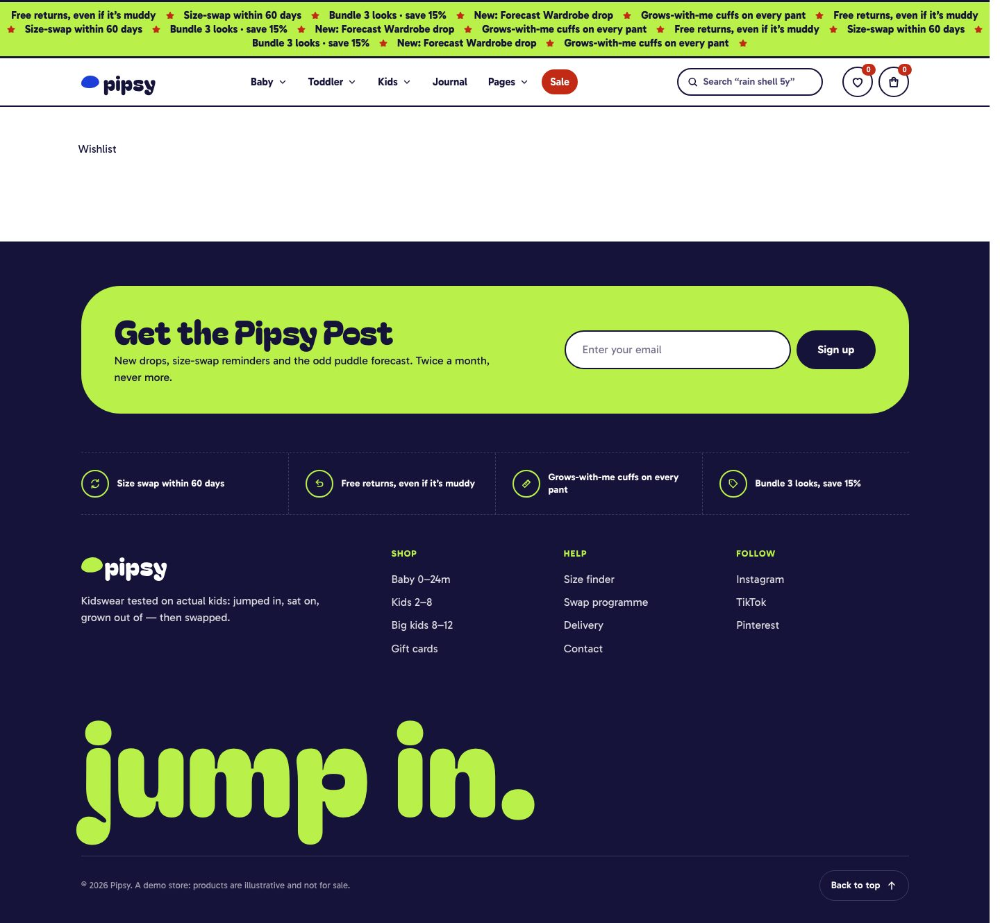

# Wishlist

The wishlist is powered by the free **WCBoost – Wishlist** plugin, styled by Pipsy.

<figure><figcaption>
The Wishlist page
</figcaption></figure>

## Where it appears

* **Header** – the heart button with a counter (Kitify WCBoost Wishlist widget in the **Pipsy — Header** template).
* **Product cards** – a heart button on each card. Turn it off in **Theme Options > Shop > Shop Archives > Show Wishlist button**.
* **Product page** – a heart button next to Add to cart.
* **Wishlist page** – the saved products as a grid of Pipsy product cards, or an empty card with a link to the shop when nothing is saved.

## The Wishlist page

The page is called **Wishlist** and is built with Elementor: a breadcrumb, a heading and a lead text, the list, and a band with size help. The list itself is the shortcode `[wcboost_wishlist]` in a Shortcode widget.

To edit the texts around the list, open **Pages > Wishlist > Edit with Elementor**.

## Settings

Go to **WooCommerce > Settings > Wishlist**. The demo uses these settings:

| Setting | Demo value |
| --- | --- |
| Guest wishlist | Enabled: visitors can save products without an account |
| Merge the guest wishlist after login | Enabled |
| AJAX add to wishlist | Enabled |
| Button on the product page | After Add to cart |
| When the product is already saved | The button links to the wishlist |
| Sharing | Enabled |

Make sure **Wishlist page** in these settings points to your Wishlist page.

For every option of the plugin, see the [WCBoost – Wishlist documentation](https://wordpress.org/plugins/wcboost-wishlist/).
